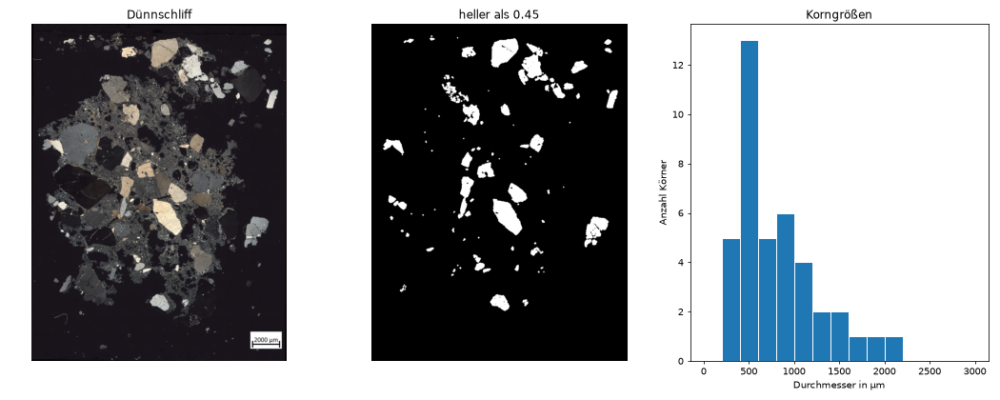
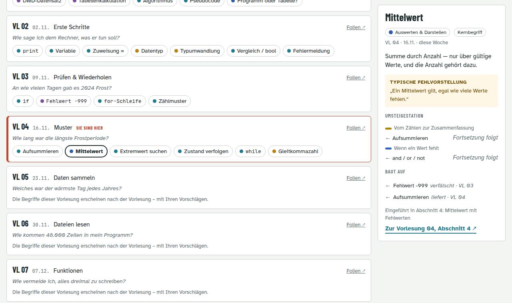

<!--

author:   Sebastian Zug & Bernhard Jung
email:    sebastian.zug@informatik.tu-freiberg.de & bernhard.jung@informatik.tu-freiberg.de
version:  2.1.2
language: de
narrator: Deutsch Female

comment:  Motivation und Organisation: Warum Programmieren für die Arbeit mit Daten? Ziele, Arbeitsweise, Semesterplan und Prüfung.

logo:     ./images/Readme/Wetterstation.png

import:   https://raw.githubusercontent.com/TUBAF-IfI-LiaScript/VL_EAVD/master/config.md
          https://raw.githubusercontent.com/jh-488/lia-blockly/main/README.md
          https://raw.githubusercontent.com/LiaTemplates/Pyodide/master/README.md

@style
.flex-container {
    display: flex;
    flex-wrap: wrap;
    align-items: stretch;
    gap: 20px;
}

.flex-child {
    flex: 1;
    min-width: 260px;
}

.eavd-person {
    border-left: 3px solid #999;
    padding: 0.2rem 0 0.2rem 0.9rem;
}
@end

-->

[](https://liascript.github.io/course/?https://github.com/TUBAF-IfI-LiaScript/VL_EAVD/blob/master/00_Motivation.md)

# Herzlich willkommen!

| Parameter                | Kursinformationen                                                                                                                          |
| ------------------------ | ------------------------------------------------------------------------------------------------------------------------------------------ |
| **Veranstaltung:**       | @config.lecture                                                                                                                            |
| **Semester**             | @config.semester                                                                                                                           |
| **Hochschule:**          | `Technische Universität Freiberg`                                                                                                          |
| **Inhalte:**             | `Motivation, Lernziele, Arbeitsweise, Semesterplan, Prüfung, Organisation`                                                                 |
| **Link auf Repository:** | [https://github.com/TUBAF-IfI-LiaScript/VL_EAVD/blob/master/00_Motivation.md](https://github.com/TUBAF-IfI-LiaScript/VL_EAVD/blob/master/00_Motivation.md) |
| **Autoren**              | @author                                                                                                                                    |

--------------------------------------------------------------------------------

<div class="flex-container">
<div class="flex-child eavd-person">

**Prof. Dr. Sebastian Zug**

Professur für Softwareentwicklung und Robotik

sebastian.zug@informatik.tu-freiberg.de

</div>
<div class="flex-child eavd-person">

**Prof. Dr. Bernhard Jung**

Professur für Virtuelle Realität und Multimedia

bernhard.jung@informatik.tu-freiberg.de

</div>
</div>

--------------------------------------------------------------------------------

## Warum sind Sie hier?

**Was motiviert Sie, an dieser Veranstaltung teilzunehmen?**

[[___ ___ ___]]


**Was verbinden Sie mit dem Begriff "Programmieren"?**

[[___ ___ ___]]


## Warum ist die Veranstaltung zentral?

Sie werden in Ihrer fachlichen Praxis Messreihen auswerten, Analysendaten sortieren und Ergebnisse darstellen müssen. Wissenschaftliche Daten durchlaufen dabei immer wieder dasselbe Muster:

``` ascii
      ┌──────────────────────── neue Frage ──────────────────────────────┐
      │                                                                  │
      ▼                                                                  │
  ┌───────┐   ┌───────┐   ┌───────┐   ┌───────┐   ┌───────┐   ┌───────┐  │
  │ FRAGE │──▶│ ERHE- │──▶│ AUFBE-│──▶│ ANALY-│──▶│ VISUA-│──▶│ DOKU- │──┘
  │       │   │ BUNG  │   │ REITEN│   │  SE   │   │ LISIE-│   │ MENTA-│
  └───────┘   └───────┘   └───────┘   └───────┘   │ RUNG  │   │ TION  │
                                                  └───────┘   └───────┘
  Hypothese   Messen      Fehlwerte   Rechnen     Diagramm    Nachvoll-
  Messgröße   Sammeln     Einheiten   Vergleichen Karte       ziehbar
  Methodik    Speichern   Ausreißer   Zusammen-   Tabelle     machen
                                      fassen
```
<!-- style="font-size: 0.75em; line-height: 1.2;" -->

> **Der Pfeil zurück ist der wichtigste.** Fast nie führt der erste Durchlauf zum Ziel: Die Daten reichen nicht, die Frage war zu unscharf, oder das Ergebnis wirft eine neue Frage auf. Auswerten heißt, diese Schleife mehrfach zu drehen.

Der Name der Veranstaltung nennt drei dieser Schritte — **Erhebung**, **Analyse** und **Visualisierung**. Und bei jedem Durchlauf stellt sich dieselbe Frage: Mache ich das von Hand, in der Tabellenkalkulation — oder schreibe ich ein Programm, das es für mich tut, jedes Mal wieder, nachvollziehbar und ohne Tippfehler?

### Lernziele

                                     {{0-1}}
*******************************************************************************

Am Ende des Semesters können Sie eine wissenschaftliche Fragestellung auf eine Datenverarbeitung abbilden — von der Rohdatei bis zur belegten Aussage. Dafür brauchen Sie beides: das Handwerkszeug und seine Anwendung.

<!-- data-type="none" -->
| Sie können ...  | Handwerkszeug                                                                  | Anwendung auf Daten                                                                    |
| :-------------- | :----------------------------------------------------------------------------- | :------------------------------------------------------------------------------------- |
| **entwickeln**  | ein eigenes Programm aus Schleifen, Bedingungen und Funktionen aufbauen          | eine vollständige Auswertung schreiben — einlesen, bereinigen, auswerten, darstellen     |
| **beurteilen**  | einschätzen, ob ein Programm verständlich und wartbar geschrieben ist            | einschätzen, ob ein Ergebnis belastbar ist und wann eine Darstellung in die Irre führt   |
| **analysieren** | fremden Python-Code lesen und nachvollziehen, was er tut                         | einen unbekannten Datensatz erschließen: Was steht drin, was fehlt darin?                |
| **anwenden**    | Variablen, Datentypen, Schleifen und Funktionen zur Lösung einer Aufgabe nutzen  | die Werkzeuge der Datenanalyse auf eigene Messreihen und Analysendaten übertragen        |
| **verstehen**   | erklären, was Variable, Datentyp, Schleife, Funktion und Modul bedeuten          | erklären, warum Daten aufbereitet werden müssen, bevor man mit ihnen rechnet             |
| **erinnern**    | die Syntax der Grundbausteine benennen                                          | die Grundbegriffe benennen: Algorithmus, Fehlwert, Bibliothek, DataFrame                 |

*******************************************************************************

                                     {{1-2}}
*******************************************************************************

**Drei Fähigkeiten, die über den Kurs hinaus tragen**

1. **Sie erkennen, wann sich Programmieren lohnt** — und wann eine Tabellenkalkulation genügt. Beides zu wissen ist mehr wert, als eine Sprache zu kennen.
2. **Sie können Ergebnisse hinterfragen** — die eigenen und die anderer. Woher kommen die Daten, was fehlt darin, was trägt die Aussage wirklich?
3. **Sie können sich selbst weiterhelfen** — Fehlermeldungen lesen, Dokumentation nutzen, Beispiele übertragen. Kein Kurs deckt ab, was Sie später brauchen werden.

> **Was ausdrücklich nicht das Ziel ist:** Sie werden keine Software-Entwickler. Kleine Vorhaben können Sie aber selbst umsetzen, größere zumindest einordnen.

*******************************************************************************

### Praktische Inhalte

> **Wann erscheinen Studierende in der Vorlesung?** Gibt es Muster — der frühe Vogel, rechtzeitig aber knapp, in den ersten zehn Minuten passiert ohnehin nichts?

Ein Ultraschallsensor an der Hörsaaltür zählt die Eintretenden. So sehen seine Aufzeichnungen aus:

``` text data.csv
16:14:28.164 -> Person counted. Total = 66
16:14:28.421 -> Person entered monitoring zone
16:14:29.869 -> Person counted. Total = 67
16:14:29.933 -> Person entered monitoring zone
16:14:32.770 -> Person counted. Total = 68
```

Eine einfache Frage, echte Messdaten — und schon stecken wir mitten in den Themen dieses Semesters:

* Wie kommen die Daten zustande? Und zählt der Sensor richtig?
* Wie macht man aus diesen Textzeilen etwas, womit man rechnen kann?
* Wie beantwortet man die Frage — heute, und jede Woche aufs Neue?

Am Ende dieser Vorlesung kommen wir darauf zurück.

### Ein Blick voraus: Körner im Dünnschliff

> **Wie groß sind die Körner in diesem Gestein — und wie viel Fläche nehmen sie ein?**

Ein **Dünnschliff** ist eine Gesteinsscheibe, die so dünn geschliffen ist (etwa 0,03 mm), dass Licht hindurchscheint. Unter dem Mikroskop liegt sie zwischen zwei gekreuzten Polarisationsfiltern. Die Mineralkörner erscheinen dann je nach Mineral und Lage hell, farbig oder dunkel.

So sieht eine Auswertung in Python aus — das ist der Kern des Programms. Sie müssen heute keine Zeile davon verstehen; achten Sie auf die Kommentare rechts.

``` python duennschliff.py
grau[900:, 640:] = 0           # Maßstab unten rechts ausblenden
UM_PRO_PIXEL = 2000 / 80       # Maßstab: 2000 µm sind 80 Pixel
SCHWELLE = 0.45     # Annahme: Ein Korn ist heller als die Schwelle
hell = ndimage.binary_opening(grau > SCHWELLE, iterations=2)  # Krümel weg
koerner, _ = ndimage.label(hell)            # zusammenhängende Flecken
flaeche = np.bincount(koerner.ravel())[1:]  # Pixel je Fleck
flaeche = flaeche[flaeche >= 150]           # sehr kleine Flecken weg
durchmesser = 2 * np.sqrt(flaeche / np.pi) * UM_PRO_PIXEL
```



Ergebnis: **40 Körner**, mittlerer Durchmesser (Median) **657 µm**, zusammen rund **13 %** der Probenfläche. Bild: Fundus von Prof. Heide, TU Bergakademie Freiberg.

Das Programm läuft in wenigen Sekunden — aber jede Zeile enthält eine Entscheidung:

<!-- data-type="none" -->
| Im Code steht ...          | Die Annahme dahinter                      | Was schiefgeht                                                         |
| :------------------------- | :---------------------------------------- | :--------------------------------------------------------------------- |
| `SCHWELLE = 0.45`          | Ab dieser Helligkeit beginnt ein Korn     | Bei 0,35 sind es 48 Körner auf 21 % der Probe, bei 0,55 nur 32 auf 11 % |
| `grau > SCHWELLE`          | Körner sind hell                          | Körner, die gerade dunkel erscheinen, fehlen ganz                       |
| `ndimage.label`            | Körner berühren sich nicht                | Zwei aneinanderliegende Körner zählen als eines                         |
| `grau[900:, 640:] = 0`     | Der Maßstab ist kein Korn                 | Ohne diese Zeile wird der Maßstabsbalken als Korn mitgezählt            |
| `UM_PRO_PIXEL = 2000 / 80` | 80 Pixel entsprechen 2000 µm              | Wer den Maßstab falsch abliest, verschiebt alle Durchmesser             |

Die Bausteine dafür lernen Sie im Semester: Bilder als Tabellen aus Zahlen und Masken in Vorlesung 10, Histogramme in Vorlesung 13. Das vollständige Programm liegt im Repository unter `examples/00_Einfuehrungsbeispiele/Duennschliff/` und läuft in Visual Studio Code.

### Und was ist mit Ihnen

**Aus welchem Studiengang kommen Sie?**

[[___ ___ ___]]

**Welche Daten würden Sie gern analysieren?**

[[___ ___ ___]]

**Welche Programmiererfahrungen haben Sie?**

[(keine)] Keine, ich habe noch nie programmiert.
[(wenig)] Ein bisschen, ich habe schon mal ein Programm geschrieben.
[(viel)] Viel, ich habe schon mehrere Programme geschrieben.

## Wie diese Vorlesung funktioniert

### Die Frage kommt zuerst

Jede Vorlesung beginnt mit einer Frage an echte Daten. Die Sprachkonzepte kommen dann, wenn man sie zur Beantwortung braucht.

``` text
statt:    "Heute beschäftigen wir uns mit Schleifen."
sondern:  "Wir müssen 48.000 Zeilen durchgehen. Wie machen wir das?"
                              ↓
                     Dafür gibt es Schleifen.
```

> Wer weiß, *wozu* ein Konzept dient, behält es. Wer es als Vokabel lernt, vergisst es nach der Klausur. Um einige Grundlagen kommen wir trotzdem nicht herum — aber immer mit Blick darauf, wofür wir sie brauchen.

### Ein Datensatz durch das ganze Semester

Roter Faden ist die Klimamessreihe des Deutschen Wetterdienstes vom **Fichtelberg** (1213 m): Tageswerte seit 1890, fast 48.000 Zeilen, frei verfügbar — und mit allen Widrigkeiten echter Daten.

```text produkt_klima_tag_18900801_20251231_01358.txt
STATIONS_ID;MESS_DATUM;QN_3;  FX;  FM;QN_4; RSK;RSKF; SDK;SHK_TAG;  NM; VPM;  PM; TMK; UPM; TXK; TNK; TGK;eor
       1358;19101210;-999;-999;-999;    1;   0.0;   0;-999;  90;   3.3;   7.2;  863.60;    3.8;   90.00;    5.4;    1.0;-999;eor
       1358;19151001;-999;-999;-999;    1;   2.0;   1;-999;   0;   8.0;   7.1;  873.70;    2.0;  100.00;    2.8;    1.0;-999;eor
```

Fehlwerte als `-999`, kryptische Spaltennamen, Datumsangaben ohne Trennzeichen — und zwischen diesen beiden Zeilen fehlen fast fünf Jahre.

> Dass dieser Datensatz "schmutzig" ist, ist kein Nachteil, sondern der Punkt. An sauberen Datensätzen lernt man nichts über Datenanalyse.

Dazu kommen Beispiele aus Ihren Fächern — Analysendaten, Bohrprofile, Pegelstände, Rohstoffpreise. Ihre Antworten auf die Umfrage oben helfen uns bei der Auswahl.

### Blöcke oder Text

> [!CAUTION]
> Das Laden der Beispiele dauert im Browser ein paar Sekunden. Bitte warten Sie, bis der Editor erscheint.

Die ersten Beispiele können Sie wahlweise als **Blöcke** zusammenschieben oder als **Text** tippen. Das sind nicht zwei Sprachen, sondern zwei Ansichten auf dasselbe Programm.

Eine Woche mit Tiefsttemperaturen — gezählt werden die **Frosttage**, an denen das Minimum unter 0 °C lag. Legen Sie sich fest, **bevor** Sie das Programm ausführen: Wie viele sind es?

[[4]]
***
-1,8 °C, -3,5 °C, -0,2 °C und -4,1 °C liegen unter null. Solche Vorhersagen machen wir in jeder Vorlesung: Erst überlegen, dann ausführen — das ist die beste Vorbereitung auf die Klausur.
***

```` @BlocklyId(frosttage, runner=frosttage hideRunner height=380)
# Gemessene Tiefsttemperaturen einer Januarwoche
temperaturen = [2.4, -1.8, -3.5, 0.7, -0.2, 1.9, -4.1]

frosttage = 0

for temperatur in temperaturen:
    if temperatur < 0:
        frosttage = frosttage + 1

print("Frosttage in dieser Woche:", frosttage)
````

```python
# runner: frosttage
```
@Pyodide.eval

Nutzen Sie die Schaltflächen über dem Editor, um zwischen Blöcken und Text zu wechseln. In Vorlesung 03 verstehen Sie jede dieser Zeilen.

### Live Hacking und typische Fehlvorstellungen

Ab Vorlesung 04 entsteht in jeder Sitzung ein Programm vor Ihren Augen — **inklusive Irrwegen, Fehlermeldungen und Korrekturen**. Programmieren ist ein Prozess, kein Ergebnis; fertiger Code auf einer Folie verschweigt genau den Teil, den Sie lernen müssen.

Außerdem begegnen Ihnen immer wieder Abschnitte **"Typische Fehlvorstellung"**: Annahmen, die fast jede und jeder am Anfang hat — und die zu Programmen führen, die ohne Fehlermeldung falsch rechnen.

### Werkzeuge

<!-- data-type="none" -->
| Wann            | Werkzeug                          | Wofür                                   |
| :-------------- | :-------------------------------- | :-------------------------------------- |
| ab heute        | Beispiele direkt im Browser       | ausprobieren ohne Installation          |
| ab Vorlesung 03 | Python auf Ihrem Rechner, Visual Studio Code | eigene Programme, Übungsaufgaben |
| ab Vorlesung 10 | Visual Studio Code mit Zellen (`# %%`) | schrittweise Datenanalyse mit Diagrammen |

> Die Beispiele im Browser sind gewöhnliches Python. Sie lassen sich eins zu eins auf Ihren Rechner übertragen.

### Erst mühsam, dann mit Werkzeug

In Vorlesung 06 lesen Sie die Rohdatei mit Bordmitteln ein — das kostet rund 50 Zeilen. In Vorlesung 11 tut dasselbe eine einzige Anweisung. Wer den mühsamen Weg gegangen ist, versteht, *was* diese Anweisung abnimmt. Wer ihn übersprungen hat, steht hilflos da, sobald sie einmal nicht funktioniert.

### Die Kurslandkarte

> **Wo stehen wir — und worauf baut auf, was heute dazukommt?**

Programmieren lernt man in Schichten: Jeder neue Begriff stützt sich auf frühere. Damit Sie diesen Zusammenhang nicht aus dem Blick verlieren, gibt es die [Kurslandkarte](https://tubaf-ifi-liascript.github.io/VL_EAVD/kurslandkarte/). Sie zeigt für jede Vorlesung die Begriffe, die neu dazukommen, und zu jedem Begriff

* eine Erklärung in einem Satz,
* die typische Fehlvorstellung, mit der viele am Anfang danebenliegen,
* worauf er aufbaut und wohin er führt,
* einen Link direkt zur passenden Folie.



**Die Karte wächst mit dem Semester.** Nach jeder Vorlesung schalten wir ihre Begriffe frei, ergänzt um Ihre Vorschläge aus der Abfrage am Ende der Vorlesung. Für kommende Vorlesungen stehen bis dahin nur Termin und Leitfrage; wer neugierig ist, sieht mit „Ausblick: An“ die vorbereiteten Begriffe blass. „Sie sind hier“ richtet sich nach dem Datum. Neben dieser Liste gibt es eine **Metrokarte**, deren Linien rote Fäden durch das Semester sind — etwa „Wenn ein Wert fehlt“ —, und eine **Zeitleiste** mit allen Begriffen und ihren Verbindungen.

<!-- data-type="none" -->
| Wann                          | Wofür                                                          |
| :---------------------------- | :------------------------------------------------------------- |
| vor der Vorlesung             | Was kommt heute dazu, und worauf baut es auf?                  |
| nach der Vorlesung            | Kann ich jeden neuen Begriff in einem Satz erklären?           |
| vor der Übung und der Klausur | Kenne ich die typische Fehlvorstellung — und warum sie falsch ist? |

Probieren Sie es aus: Suchen Sie in der Kurslandkarte den Begriff „Fehlwert -999“. In welcher Vorlesung kommt er dazu?

[( )] Vorlesung 01
[(X)] Vorlesung 03
[( )] Vorlesung 06
[( )] Vorlesung 11
***
In Vorlesung 03 („Prüfen und Wiederholen“). Er baut auf dem DWD-Datensatz aus Vorlesung 01 auf und führt unter anderem zum Mittelwert in Vorlesung 04: Wer `-999` mitrechnet, verfälscht den Mittelwert.
***

### Offene Materialien

**Im Browser, ohne Installation.** Alle Vorlesungen sind mit [LiaScript](https://liascript.github.io) geschrieben: interaktive Dokumente, die direkt im Browser laufen. Die Beispiele lassen sich ausführen und verändern, die Quizfragen werten sofort aus. Über die Einstellungen oben rechts (Symbol mit Schiebereglern) wechseln Sie zwischen Präsentation, Folien und Lehrbuch.

**Frei verfügbar.** Die Materialien stehen unter der Lizenz [CC BY 4.0](https://creativecommons.org/licenses/by/4.0/deed.de): Sie dürfen sie nutzen, teilen und bearbeiten, solange Sie die Urheber nennen. Alles liegt offen unter [github.com/TUBAF-IfI-LiaScript/VL_EAVD](https://github.com/TUBAF-IfI-LiaScript/VL_EAVD).

**Lebendig.** Die Materialien ändern sich im Lauf des Semesters, auch durch Ihre Hinweise. Die Versionsnummer im Kopf jeder Vorlesung zeigt, wann sich etwas geändert hat.

**Machen Sie mit.**

* Fehler und Unklarheiten melden Sie im OPAL-Forum, per E-Mail oder, wenn Sie GitHub nutzen, als [Issue](https://github.com/TUBAF-IfI-LiaScript/VL_EAVD/issues).
* Verbesserungen können Sie auf GitHub auch direkt als Änderung vorschlagen.
* Wer zu einer Vorlesung beiträgt, wird in dieser Vorlesung als **Mitautorin oder Mitautor** genannt.

## Semesterplan

Die Vorlesung findet montags statt. Vor Weihnachten legen wir die Grundlagen, danach geht es um Datenanalyse.

<!-- data-type="none" -->
| Termin | VL | Thema                                         | Leitfrage                                               |
| :----- | :- | :-------------------------------------------- | :------------------------------------------------------ |
| 19.10. | 00 | Motivation, Organisation                      | Warum sollte ich programmieren lernen?                  |
| 26.10. | [01](https://liascript.github.io/course/?https://raw.githubusercontent.com/TUBAF-IfI-LiaScript/VL_EAVD/master/01_VomProblemZumProgramm.md) | Vom Problem zum Programm                      | Wo hört die Tabellenkalkulation auf?                    |
| 02.11. | [02](https://liascript.github.io/course/?https://raw.githubusercontent.com/TUBAF-IfI-LiaScript/VL_EAVD/master/02_ErsteSchritte.md) | Erste Schritte in Python                      | Wie sage ich dem Rechner, was er tun soll?              |
| 09.11. | [03](https://liascript.github.io/course/?https://raw.githubusercontent.com/TUBAF-IfI-LiaScript/VL_EAVD/master/03_PruefenUndWiederholen.md) | Prüfen und Wiederholen                        | An wie vielen Tagen gab es 2024 Frost?                  |
| 16.11. | [04](https://liascript.github.io/course/?https://raw.githubusercontent.com/TUBAF-IfI-LiaScript/VL_EAVD/master/04_MusterInMessreihen.md) | Muster in Messreihen                          | Wie lang war die längste Frostperiode?                  |
| 23.11. | [05](https://liascript.github.io/course/?https://raw.githubusercontent.com/TUBAF-IfI-LiaScript/VL_EAVD/master/05_DatenSammeln.md) | Daten sammeln                                 | Welches war der wärmste Tag jedes Jahres?               |
| 30.11. | [06](https://liascript.github.io/course/?https://raw.githubusercontent.com/TUBAF-IfI-LiaScript/VL_EAVD/master/06_DateienLesen.md) | Dateien lesen                                 | Wie kommen 48.000 Zeilen in mein Programm?              |
| 07.12. | [07](https://liascript.github.io/course/?https://raw.githubusercontent.com/TUBAF-IfI-LiaScript/VL_EAVD/master/07_Funktionen.md) | Funktionen                                    | Wie vermeide ich, alles dreimal zu schreiben?           |
| 14.12. | [08](https://liascript.github.io/course/?https://raw.githubusercontent.com/TUBAF-IfI-LiaScript/VL_EAVD/master/08_DemoMicroPython.md) | Demonstration: Datenerhebung mit MicroPython  | Wo kommen die Daten eigentlich her?                     |
| 04.01. | [09](https://liascript.github.io/course/?https://raw.githubusercontent.com/TUBAF-IfI-LiaScript/VL_EAVD/master/09_ProgrammeStrukturieren.md) | Programme strukturieren                       | Wie organisiere ich Code, der wächst?                   |
| 11.01. | [10](https://liascript.github.io/course/?https://raw.githubusercontent.com/TUBAF-IfI-LiaScript/VL_EAVD/master/10_Bibliotheken.md) | Bibliotheken: NumPy                           | Warum muss ich das Rad nicht neu erfinden?              |
| 18.01. | [11](https://liascript.github.io/course/?https://raw.githubusercontent.com/TUBAF-IfI-LiaScript/VL_EAVD/master/11_PandasEinlesen.md) | pandas I — Einlesen                           | 48.000 Zeilen in einer Anweisung?                       |
| 25.01. | [12](https://liascript.github.io/course/?https://raw.githubusercontent.com/TUBAF-IfI-LiaScript/VL_EAVD/master/12_PandasAggregieren.md) | pandas II — Aggregieren                       | Wie fasse ich Jahrzehnte zusammen?                      |
| 01.02. | [13](https://liascript.github.io/course/?https://raw.githubusercontent.com/TUBAF-IfI-LiaScript/VL_EAVD/master/13_Visualisierung.md) | Visualisierung                                | Wie zeige ich, was ich gefunden habe?                   |
| 08.02. | [14](https://liascript.github.io/course/?https://raw.githubusercontent.com/TUBAF-IfI-LiaScript/VL_EAVD/master/14_Datenqualitaet.md) | Datenqualität, Ausblick, Prüfungsvorbereitung | Kann ich meinem Ergebnis trauen?                        |

## Prüfung

Die Veranstaltung schließt mit einer **schriftlichen Prüfung** ab.

Eine Klausur prüft nicht, ob Sie eine Analyse *bauen* können, sondern ob Sie Code **lesen, verstehen, korrigieren und skizzieren** können. Darauf bereiten wir gezielt vor:

<!-- data-type="none" -->
| Kompetenz                           | Wie sie geübt wird                                      |
| :---------------------------------- | :------------------------------------------------------ |
| Code lesen und Ergebnis vorhersagen | Vorhersage-Fragen in jeder Vorlesung                    |
| Fehler finden                       | Live Hacking mit echten Irrwegen, typische Fehlvorstellungen |
| Code auf Papier schreiben           | Übungsaufgaben ohne Rechner                             |
| Konzepte erklären                   | Skizzenaufgaben, Schwerpunkt Datenanalyse               |

**Was in der Klausur vorkommt**

+ _Welchen Wert gibt das folgende Programm in Zeile x aus?_
+ _Finden Sie alle syntaktischen und logischen Fehler im nachfolgenden Code._
+ _Schreiben Sie eine Funktion, die ..._
+ _Was macht `groupby` mit dieser Tabelle? Skizzieren Sie das Ergebnis._
+ _Warum ist diese Darstellung irreführend?_
+ _Warum ist `-999` in diesem Datensatz ein Problem?_

**Was nicht vorkommt:** auswendig gelernte Bibliothekssyntax und die Inhalte der Mikrocontroller-Demonstration.

Vorlesung 14 enthält eine Prüfungsvorbereitung mit Musteraufgaben.

> Studierende der _Einführung in die Informatik_ (7 LP) bearbeiten neben der Klausur eine praktische Programmieraufgabe. Thema und Umfang stimmen Sie mit den Übungsbetreuern ab.

## Organisatorisches

<!-- TODO WiSe 2026/27: Team (Übungsbetreuer, Tutoren) ergänzen -->

**Übungen.** Die Übungen vertiefen jede Vorlesung an Programmieraufgaben zum Datensatz der Woche — ein Teil davon bewusst auf Papier, als Vorbereitung auf die Klausur. Sie beginnen in der zweiten Vorlesungswoche, also ab Montag, 26.10. Wählen Sie einen der vier Termine:

<!-- data-type="none" -->
| Tag      | Uhrzeit       | Raum     |
| :------- | :------------ | :------- |
| Montag   | 14:30–16:00   | RAM-2119 |
| Mittwoch | 8:00–9:30     | RAM-2119 |
| Mittwoch | 8:00–9:30     | KKB-2097 |
| Mittwoch | 18:00–19:30   | RAM-2119 |

In der ersten Übung richten wir gemeinsam Python und Visual Studio Code ein. Danach gehört jedes Übungsblatt zur Vorlesung der Woche: Sie versuchen sich bis zur Übung der Folgewoche daran, dort besprechen wir es.

<!-- TODO WiSe 2026/27: Einschreibung (OPAL), Abgabeform -->

**Materialien.** Alle Vorlesungen, Daten und Beispiele finden Sie unter [github.com/TUBAF-IfI-LiaScript/VL_EAVD](https://github.com/TUBAF-IfI-LiaScript/VL_EAVD); wie Sie mitmachen können, steht im Abschnitt „Offene Materialien“.

**Zeitaufwand.** 180 h: 60 h Präsenzzeit und 120 h Selbststudium für Vor- und Nachbereitung, Übungsaufgaben und Prüfungsvorbereitung. Ohne Programmiererfahrung sollten Sie eher mehr Zeit einplanen — in einer Arbeitsgruppe macht das deutlich mehr Spaß als allein.

**Wie Sie zum Gelingen beitragen können**

+ Stellen Sie Fragen — in der Vorlesung, in der Übung, im OPAL-Forum.
+ Bringen Sie Beispiele aus Ihrem Fach mit.
+ Melden Sie Fehler und Verbesserungsvorschläge zu den Materialien — im OPAL-Forum, per E-Mail oder als Issue auf GitHub.

## Zurück zum Personenzähler

So sieht der Kern des Messprogramms auf dem Mikrocontroller aus — in Python:

``` python personenzaehler.py
# Auszug: Initialisierung und Sensorzugriff sind ausgelassen
RANGE_MIN = 60              # Überwachungsbereich in cm
RANGE_MAX = 200
DEBOUNCE_TIME = 1000        # ms zwischen zwei Zählungen

while True:
    distance = get_distance()
    current_time = time.ticks_ms()
    in_range = RANGE_MIN <= distance <= RANGE_MAX

    if in_range and not person_detected:            # jemand betritt den Bereich
        person_detected = True

    if not in_range and person_detected:            # jemand verlässt ihn
        if time.ticks_diff(current_time, last_count_time) > DEBOUNCE_TIME:
            people_count += 1
            last_count_time = current_time
        person_detected = False
```

Sie müssen heute keine Zeile davon verstehen. Aber schon die Namen verraten, welche Annahmen darin stecken:

<!-- data-type="none" -->
| Im Code steht ...        | Die Annahme dahinter                                | Was schiefgeht                                   |
| :----------------------- | :-------------------------------------------------- | :----------------------------------------------- |
| `RANGE_MIN`, `RANGE_MAX` | Personen gehen in 60–200 cm Abstand vorbei           | Wer dichter an der Wand läuft, wird nie gezählt   |
| `DEBOUNCE_TIME = 1000`   | Zwischen zwei Personen liegt mehr als eine Sekunde   | Zwei nebeneinander sind eine Messung              |
| kein Richtungssinn       | Wer eintritt, bleibt drin                            | Wer noch einmal hinausgeht, wird doppelt gezählt  |

**Es funktioniert. Und zählt trotzdem falsch.** Jede Zahl in einer Datentabelle hatte einmal ein Messgerät, eine Genauigkeit und ein Ausfallrisiko. In Vorlesung 08 sehen wir so eine Messung live.

## Ihre Begriffe für die Kurslandkarte

Die [Kurslandkarte](https://tubaf-ifi-liascript.github.io/VL_EAVD/kurslandkarte/) wächst mit dem Semester, und Sie bestimmen mit, was hineinkommt. Ihre Antworten sammeln wir im Hörsaal gemeinsam; nach der Vorlesung werden die Begriffe dieser Woche in der Karte freigeschaltet.

**Welche Begriffe aus der heutigen Vorlesung gehören für Sie in die Kurslandkarte?**

[[___ ___ ___]]

**Wo könnten Sie das, was heute dran war, in Ihrem Fach anwenden?**

[[___ ___ ___]]

## Nächste Woche

Sie bekommen die Datei des Personenzählers und die Fichtelberg-Daten — und versuchen, drei Fragen mit einer Tabellenkalkulation zu beantworten. Ohne eine Zeile Code.

**Bringen Sie einen Laptop mit einer Tabellenkalkulation mit** — LibreOffice Calc, Excel oder Google Sheets.
