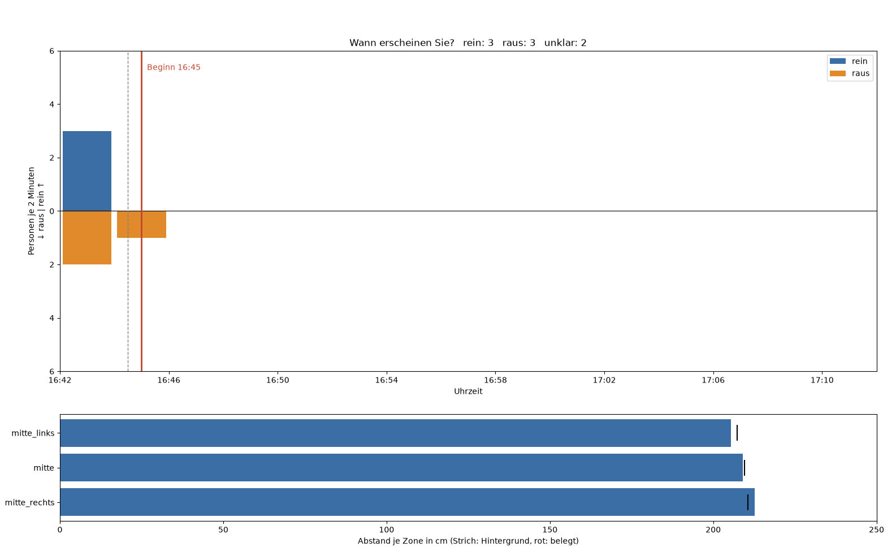
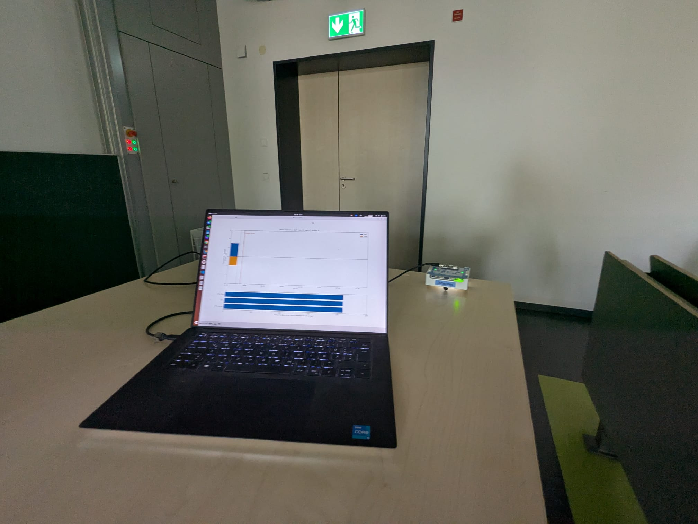

<!--

author:   Sebastian Zug & Bernhard Jung
email:    sebastian.zug@informatik.tu-freiberg.de & bernhard.jung@informatik.tu-freiberg.de
version:  2.4.0
language: de
narrator: Deutsch Female

comment:  Motivation und Organisation: Warum Programmieren für die Arbeit mit Daten? Ziele, Arbeitsweise, Semesterplan und Prüfung.

logo:     ./images/Readme/Wetterstation.png

import:   https://raw.githubusercontent.com/TUBAF-IfI-LiaScript/VL_EAVD/master/config.md
          https://raw.githubusercontent.com/jh-488/lia-blockly/main/README.md
          https://raw.githubusercontent.com/LiaTemplates/Pyodide/master/README.md

@style
.flex-container {
    display: flex;
    flex-wrap: wrap;
    align-items: stretch;
    gap: 20px;
}

.flex-child {
    flex: 1;
    min-width: 260px;
}

.eavd-person {
    border-left: 3px solid #999;
    padding: 0.2rem 0 0.2rem 0.9rem;
}
@end

-->

[](https://liascript.github.io/course/?https://github.com/TUBAF-IfI-LiaScript/VL_EAVD/blob/master/00_Motivation.md)

# Herzlich willkommen!

| Parameter                | Kursinformationen                                                                                                                          |
| ------------------------ | ------------------------------------------------------------------------------------------------------------------------------------------ |
| **Veranstaltung:**       | @config.lecture                                                                                                                            |
| **Semester**             | @config.semester                                                                                                                           |
| **Hochschule:**          | `Technische Universität Freiberg`                                                                                                          |
| **Inhalte:**             | `Motivation, Lernziele, Arbeitsweise, Semesterplan, Prüfung, Organisation`                                                                 |
| **Link auf Repository:** | [https://github.com/TUBAF-IfI-LiaScript/VL_EAVD/blob/master/00_Motivation.md](https://github.com/TUBAF-IfI-LiaScript/VL_EAVD/blob/master/00_Motivation.md) |
| **Autoren**              | @author                                                                                                                                    |

> **Zum Nacharbeiten: die Ansicht „Lehrbuch“.** Im Hörsaal zeigen die Folien nur die Kernbotschaften. Die Erklärungen dazu stehen im Lehrbuch: oben rechts auf das Symbol mit den Schiebereglern klicken und „Lehrbuch“ wählen.

--------------------------------------------------------------------------------

<div class="flex-container">
<div class="flex-child eavd-person">

**Prof. Dr. Sebastian Zug**

Professur für Softwareentwicklung und Robotik

sebastian.zug@informatik.tu-freiberg.de

</div>
<div class="flex-child eavd-person">

**Prof. Dr. Bernhard Jung**

Professur für Virtuelle Realität und Multimedia

bernhard.jung@informatik.tu-freiberg.de

</div>
</div>

--------------------------------------------------------------------------------

## Warum sind Sie hier?

**Was motiviert Sie, an dieser Veranstaltung teilzunehmen?**

[[___ ___ ___]]


**Was verbinden Sie mit dem Begriff "Programmieren"?**

[[___ ___ ___]]


## Warum ist die Veranstaltung zentral?

In Ihrem Fach werden Sie Messreihen auswerten, Analysendaten sortieren und Ergebnisse darstellen. Die Daten durchlaufen dabei immer wieder dasselbe Muster:

``` ascii
      ┌──────────────────────── neue Frage ──────────────────────────────┐
      │                                                                  │
      ▼                                                                  │
  ┌───────┐   ┌───────┐   ┌───────┐   ┌───────┐   ┌───────┐   ┌───────┐  │
  │ FRAGE │──▶│ ERHE- │──▶│ AUFBE-│──▶│ ANALY-│──▶│ VISUA-│──▶│ DOKU- │──┘
  │       │   │ BUNG  │   │ REITEN│   │  SE   │   │ LISIE-│   │ MENTA-│
  └───────┘   └───────┘   └───────┘   └───────┘   │ RUNG  │   │ TION  │
                                                  └───────┘   └───────┘
  Hypothese   Messen      Fehlwerte   Rechnen     Diagramm    Nachvoll-
  Messgröße   Sammeln     Einheiten   Vergleichen Karte       ziehbar
  Methodik    Speichern   Ausreißer   Zusammen-   Tabelle     machen
                                      fassen
```
<!-- style="font-size: 0.75em; line-height: 1.2;" -->

> **Der Pfeil zurück ist der wichtigste.** Fast nie führt der erste Durchlauf zum Ziel — auswerten heißt, diese Schleife mehrfach zu drehen.

**Von Hand oder mit einem Programm?** Diese Frage stellt sich bei jedem Durchlauf.

                                    --{{0}}--
Die Daten reichen nicht, die Frage war zu unscharf, oder das Ergebnis wirft eine neue Frage auf. Der Name der Veranstaltung nennt drei der Schritte — Erhebung, Analyse und Visualisierung. Ein Programm erledigt sie jedes Mal wieder, nachvollziehbar und ohne Tippfehler; die Tabellenkalkulation verlangt jedes Mal neue Handarbeit.

### Lernziele

                                     {{0-1}}
*******************************************************************************

Am Ende des Semesters können Sie eine wissenschaftliche Fragestellung auf eine Datenverarbeitung abbilden — von der Rohdatei bis zur belegten Aussage. Dafür brauchen Sie beides: das Handwerkszeug und seine Anwendung.

<!-- data-type="none" -->
| Sie können ...  | Handwerkszeug                                                                  | Anwendung auf Daten                                                                    |
| :-------------- | :----------------------------------------------------------------------------- | :------------------------------------------------------------------------------------- |
| **entwickeln**  | ein eigenes Programm aus Schleifen, Bedingungen und Funktionen aufbauen          | eine vollständige Auswertung schreiben — einlesen, bereinigen, auswerten, darstellen     |
| **beurteilen**  | einschätzen, ob ein Programm verständlich und wartbar geschrieben ist            | einschätzen, ob ein Ergebnis belastbar ist und wann eine Darstellung in die Irre führt   |
| **analysieren** | fremden Python-Code lesen und nachvollziehen, was er tut                         | einen unbekannten Datensatz erschließen: Was steht drin, was fehlt darin?                |
| **anwenden**    | Variablen, Datentypen, Schleifen und Funktionen zur Lösung einer Aufgabe nutzen  | die Werkzeuge der Datenanalyse auf eigene Messreihen und Analysendaten übertragen        |
| **verstehen**   | erklären, was Variable, Datentyp, Schleife, Funktion und Modul bedeuten          | erklären, warum Daten aufbereitet werden müssen, bevor man mit ihnen rechnet             |
| **erinnern**    | die Syntax der Grundbausteine benennen                                          | die Grundbegriffe benennen: Algorithmus, Fehlwert, Bibliothek, DataFrame                 |

*******************************************************************************

                                     {{1-2}}
*******************************************************************************

**Drei Fähigkeiten, die über den Kurs hinaus tragen**

1. **Sie erkennen, wann sich Programmieren lohnt** — und wann eine Tabellenkalkulation genügt. Beides zu wissen ist mehr wert, als eine Sprache zu kennen.
2. **Sie können Ergebnisse hinterfragen** — die eigenen und die anderer. Woher kommen die Daten, was fehlt darin, was trägt die Aussage wirklich?
3. **Sie können sich selbst weiterhelfen** — Fehlermeldungen lesen, Dokumentation nutzen, Beispiele übertragen. Kein Kurs deckt ab, was Sie später brauchen werden.

> **Was ausdrücklich nicht das Ziel ist:** Sie werden keine Software-Entwickler. Kleine Vorhaben können Sie aber selbst umsetzen, größere zumindest einordnen.

*******************************************************************************

### Praktische Inhalte

                {{0-1}}
*****************************************

> **Forschungsfrage: Wie groß sind die Körner in diesem Gestein — und wie viel Fläche nehmen sie ein?**

Ein **Dünnschliff** ist eine Gesteinsscheibe, so dünn geschliffen, dass Licht hindurchscheint. Sie müssen heute keine Zeile des Programms verstehen — achten Sie nur auf die Kommentare rechts:

``` python duennschliff.py
grau[900:, 640:] = 0           # Maßstab unten rechts ausblenden
UM_PRO_PIXEL = 2000 / 80       # Maßstab: 2000 µm sind 80 Pixel
SCHWELLE = 0.45     # Annahme: Ein Korn ist heller als die Schwelle
hell = ndimage.binary_opening(grau > SCHWELLE, iterations=2)  # Krümel weg
koerner, _ = ndimage.label(hell)            # zusammenhängende Flecken
flaeche = np.bincount(koerner.ravel())[1:]  # Pixel je Fleck
flaeche = flaeche[flaeche >= 150]           # sehr kleine Flecken weg
durchmesser = 2 * np.sqrt(flaeche / np.pi) * UM_PRO_PIXEL
```

Ergebnis: **40 Körner**, mittlerer Durchmesser (Median) **657 µm**, zusammen rund **13 %** der Probenfläche. Bild: Fundus von Prof. Heide, TU Bergakademie Freiberg.

<!-- style="max-height: 28vh;" -->

Zum Ausprobieren: Das vollständige Programm liegt unter [`examples/00_Einfuehrungsbeispiele/Duennschliff/`](https://github.com/TUBAF-IfI-LiaScript/VL_EAVD/tree/master/examples/00_Einfuehrungsbeispiele/Duennschliff) und läuft in Visual Studio Code.

                                    --{{0}}--
Der Schliff ist etwa 0,03 mm dick. Unter dem Mikroskop liegt er zwischen zwei gekreuzten Polarisationsfiltern; die Mineralkörner erscheinen dann je nach Mineral und Lage hell, farbig oder dunkel. Das Programm sucht die hellen Flecken, zählt sie und rechnet ihre Fläche über den Maßstab in Mikrometer um.

*****************************************

                {{1-2}}
*****************************************

> **Wann erscheinen Studierende in der Vorlesung?** Gibt es Muster — der frühe Vogel, rechtzeitig aber knapp, in den ersten zehn Minuten passiert ohnehin nichts?

Ein kleiner Roboter an der Hörsaaltür zählt, wer hereinkommt und wer hinausgeht — auch heute, während Sie hereinkommen. Ein Auszug aus einem Probelauf:

``` text zaehlungen_2026-10-15.csv
zeit;richtung
2026-10-15T16:42:31;raus
2026-10-15T16:42:32;unklar
2026-10-15T16:42:36;raus
2026-10-15T16:42:40;rein
2026-10-15T16:43:04;unklar
2026-10-15T16:43:08;rein
```

<!-- style="max-height: 50vh;" -->

                                    --{{1}}--
Eine einfache Frage, echte Messdaten — und schon stecken wir mitten in den Themen dieses Semesters. Am Ende dieser Vorlesung kommen wir darauf zurück.

*****************************************

### Und was ist mit Ihnen?

> [!TIP]
> Welche Forschungsfragen sind für Sie interessant?

**Aus welchem Studiengang kommen Sie?**

[[___ ___ ___]]

**Welche Daten würden Sie gern analysieren?**

[[___ ___ ___]]

**Welche Programmiererfahrungen haben Sie?**

[(keine)] Keine, ich habe noch nie programmiert.
[(wenig)] Ein bisschen, ich habe schon mal ein Programm geschrieben.
[(viel)] Viel, ich habe schon mehrere Programme geschrieben.

## Kernkonzepte der Vorlesung

Jede Vorlesung beginnt mit einer Frage an echte Daten. Die Sprachkonzepte kommen dann, wenn man sie zur Beantwortung braucht.

``` text
statt:    "Heute beschäftigen wir uns mit Schleifen."
sondern:  "Wir müssen 48.000 Zeilen durchgehen. Wie machen wir das?"
                              ↓
                     Dafür gibt es Schleifen.
```

> Wer weiß, *wozu* ein Konzept dient, behält es.

                                    --{{0}}--
Wer ein Konzept als Vokabel lernt, vergisst es nach der Klausur. Um einige Grundlagen kommen wir trotzdem nicht herum — aber immer mit Blick darauf, wofür wir sie brauchen.

### Ein Datensatz durch das ganze Semester

Roter Faden ist die Klimamessreihe des Deutschen Wetterdienstes vom **Fichtelberg** (1213 m): Tageswerte seit 1890, fast 48.000 Zeilen, frei verfügbar — und mit allen Widrigkeiten echter Daten.

```text produkt_klima_tag_18900801_20251231_01358.txt
STATIONS_ID;MESS_DATUM;QN_3;  FX;  FM;QN_4; RSK;RSKF; SDK;SHK_TAG;  NM; VPM;  PM; TMK; UPM; TXK; TNK; TGK;eor
       1358;19101210;-999;-999;-999;    1;   0.0;   0;-999;  90;   3.3;   7.2;  863.60;    3.8;   90.00;    5.4;    1.0;-999;eor
       1358;19151001;-999;-999;-999;    1;   2.0;   1;-999;   0;   8.0;   7.1;  873.70;    2.0;  100.00;    2.8;    1.0;-999;eor
```

Fehlwerte als `-999`, kryptische Spaltennamen, Datumsangaben ohne Trennzeichen — und zwischen diesen beiden Zeilen fehlen fast fünf Jahre.

> Dass dieser Datensatz "schmutzig" ist, ist kein Nachteil, sondern der Punkt. An sauberen Datensätzen lernt man nichts über Datenanalyse.

Dazu kommen Beispiele aus Ihren Fächern — Analysendaten, Bohrprofile, Pegelstände, Rohstoffpreise.

                                    --{{0}}--
Ihre Antworten auf die Umfrage „Und was ist mit Ihnen“ helfen uns bei der Auswahl.

### Blöcke oder Text

> [!CAUTION]
> Das Laden der Beispiele dauert im Browser ein paar Sekunden. Bitte warten Sie, bis der Editor erscheint.

Die ersten Beispiele können Sie wahlweise als **Blöcke** zusammenschieben oder als **Text** tippen. Das sind nicht zwei Sprachen, sondern zwei Ansichten auf dasselbe Programm.

Eine Woche mit Tiefsttemperaturen — gezählt werden die **Frosttage**, an denen das Minimum unter 0 °C lag. Legen Sie sich fest, **bevor** Sie das Programm ausführen: Wie viele sind es?

[[4]]
***
-1,8 °C, -3,5 °C, -0,2 °C und -4,1 °C liegen unter null. Solche Vorhersagen machen wir in jeder Vorlesung: Erst überlegen, dann ausführen — das ist die beste Vorbereitung auf die Klausur.
***

```` @BlocklyId(frosttage, runner=frosttage hideRunner height=380)
# Gemessene Tiefsttemperaturen einer Januarwoche
temperaturen = [2.4, -1.8, -3.5, 0.7, -0.2, 1.9, -4.1]

frosttage = 0

for temperatur in temperaturen:
    if temperatur < 0:
        frosttage = frosttage + 1

print("Frosttage in dieser Woche:", frosttage)
````

```python
# runner: frosttage
```
@Pyodide.eval

Nutzen Sie die Schaltflächen über dem Editor, um zwischen Blöcken und Text zu wechseln. In Vorlesung 03 verstehen Sie jede dieser Zeilen.

### Typische Fehlvorstellungen

In jeder Vorlesung begegnen Ihnen Annahmen, die zu Programmen führen, die ohne Fehlermeldung falsch rechnen. Sie geben vorher eine Vorhersage ab — und merken, wenn Sie danebenliegen. Ein Beispiel:

> **Typische Fehlvorstellung:** _„Wenn das Programm ohne Fehlermeldung durchläuft, stimmt das Ergebnis.“_

Vier Tagesmittel vom Fichtelberg, eines davon fehlt und steht als `-999` in der Datei. Legen Sie sich fest, **bevor** Sie das Programm ausführen: Was gibt es aus?

```python mittel.py
temperaturen = [-1.8, -3.5, -999, 0.7]
mittel = sum(temperaturen) / len(temperaturen)
print("Mittlere Temperatur:", round(mittel, 1))
```
@Pyodide.eval

> [!TIP]
> Fehlvorstellungen sind ein typisches Problem, das fast alle am Anfang haben. Wer sie kennt und versteht, läuft nicht in die Falle.

                                    --{{0}}--
Python rechnet `-999` klaglos mit: (-1,8 - 3,5 - 999 + 0,7) / 4 = -250,9. Keine Fehlermeldung, aber ein unsinniges Ergebnis. Ohne den Fehlwert wären es -1,5 °C. Wie man Fehlwerte erkennt und auslässt, lernen Sie in Vorlesung 03.

### Erst mühsam, dann mit Werkzeug

> **Die Wetterdatei einlesen: in Vorlesung 06 rund 50 Zeilen, in Vorlesung 11 eine Anweisung.**

Dieselbe Frage zweimal — wie warm ist es auf dem Fichtelberg im Mittel aller Tage seit 1890? Von Hand (Vorlesung 06, hier nur der Kern):

```python von_hand.py
werte = []
dateiname = "data/fichtelberg/produkt_klima_tag_18900801_20251231_01358.txt"
with open(dateiname) as datei:
    datei.readline()                  # Kopfzeile überspringen
    for zeile in datei:
        spalten = zeile.split(";")
        tmk = float(spalten[13])      # Spalte 13: Tagesmittel TMK
        if tmk != -999:               # Fehlwert auslassen
            werte.append(tmk)
print(round(sum(werte) / len(werte), 2))
```

Mit der Bibliothek pandas (Vorlesung 11):

```python mit_pandas.py
import pandas as pd
dateiname = "data/fichtelberg/produkt_klima_tag_18900801_20251231_01358.txt"
df = pd.read_csv(dateiname, sep=";", skipinitialspace=True, na_values=-999)
print(round(df["TMK"].mean(), 2))
```

Beide liefern `3.24` (°C). Wer den mühsamen Weg gegangen ist, versteht, *was* `read_csv` abnimmt — Trennzeichen, Kopfzeile, Fehlwerte. Wer ihn übersprungen hat, steht hilflos da, sobald es einmal nicht funktioniert.

### Und was ist mit KI?

> **Wer die Begriffe nicht kennt, kann auch die Hilfe einer KI nicht nutzen.**

KI-Assistenten schreiben in Sekunden Python-Code. Aber Sie müssen sagen können, was Sie wollen — und prüfen können, ob das Ergebnis stimmt.

<!-- data-type="none" -->
|                     | Ohne Begriffe                              | Mit Begriffen                                                                                     |
| :------------------ | :----------------------------------------- | :------------------------------------------------------------------------------------------------ |
| **Frage an die KI** | „Wie warm ist es auf dem Fichtelberg?“      | „Lies die DWD-Datei mit `;` als Trennzeichen, lass in der Spalte TMK die Fehlwerte `-999` weg und bilde den Mittelwert.“ |
| **Antwort prüfen**  | „Das Programm läuft, also stimmt es.“       | „Wird `-999` wirklich ausgelassen? Ist es die richtige Spalte?“                                     |

                                    --{{0}}--
Eine KI ist ein Werkzeug wie die Tabellenkalkulation oder pandas: Sie nimmt Arbeit ab, aber kein Verständnis. Erinnern Sie sich an die -250,9 °C: Ein Programm von einer KI, das den Fehlwert mitrechnet, läuft genauso ohne Fehlermeldung. Wer Code lesen kann und die Begriffe kennt, merkt das. Genau das üben wir in diesem Semester — und genau das prüft die Klausur.

## Vorlesungsmaterialien

<!-- data-type="none" -->
| In der Vorlesung     | Werkzeug                                        | Wofür                                      |
| :------------------- | :---------------------------------------------- | :----------------------------------------- |
| in jeder Vorlesung   | Beispiele direkt im Browser                     | ausprobieren ohne Installation             |
| ab Vorlesung 03      | dazu Python in Visual Studio Code               | Programme mit echten Dateien               |
| ab Vorlesung 10      | dazu Jupyter Notebooks in Visual Studio Code   | schrittweise Datenanalyse mit Diagrammen   |

**In den Übungen** arbeiten Sie mit Visual Studio Code auf Ihrem eigenen Rechner — eingerichtet wird es in der ersten Übung.

> Die Beispiele im Browser sind gewöhnliches Python. Sie lassen sich eins zu eins auf Ihren Rechner übertragen.

Dasselbe Mini-Programm hier im Browser und gleich in Visual Studio Code als Datei `welcome.py`:

```python welcome.py
print("Herzlich willkommen in der Vorlesung!")
```
@Pyodide.eval

Beide Male lautet die Ausgabe `Herzlich willkommen in der Vorlesung!`. Nur der Ort, an dem Python läuft, ist ein anderer. Die Datei liegt auch im Repository: [`examples/00_Einfuehrungsbeispiele/welcome.py`](https://github.com/TUBAF-IfI-LiaScript/VL_EAVD/blob/master/examples/00_Einfuehrungsbeispiele/welcome.py).

### Die Kurslandkarte

> **Wo stehen wir — und worauf baut auf, was heute dazukommt?**

Die [Kurslandkarte](https://tubaf-ifi-liascript.github.io/VL_EAVD/kurslandkarte/) zeigt für jede Vorlesung die neuen Begriffe, und zu jedem Begriff

* eine Erklärung in einem Satz,
* die typische Fehlvorstellung, mit der viele am Anfang danebenliegen,
* worauf er aufbaut und wohin er führt,
* einen Link direkt zur passenden Folie.

<!-- style="max-height: 28vh;" -->

**Die Karte wächst mit dem Semester** — nach jeder Vorlesung kommen ihre Begriffe dazu, auch Ihre Vorschläge.

                                    --{{0}}--
Programmieren lernt man in Schichten: Jeder neue Begriff stützt sich auf frühere. Die Karte hält diesen Zusammenhang fest. Für kommende Vorlesungen stehen zunächst nur Termin und Leitfrage; wer neugierig ist, sieht mit „Ausblick: An“ die vorbereiteten Begriffe blass. „Sie sind hier“ richtet sich nach dem Datum. Neben der Liste gibt es eine Metrokarte, deren Linien rote Fäden durch das Semester sind — etwa „Wenn ein Wert fehlt“ —, und eine Zeitleiste mit allen Begriffen nach Themengebiet.

> [!NOTE]
> Am Ende jeder Vorlesung fragen wir Sie nach den Stichworten des Tages und tragen sie in die Kurslandkarte ein.

### Offene Materialien

* **Im Browser, ohne Installation:** geschrieben mit [LiaScript](https://liascript.github.io), Beispiele zum Ausführen und Verändern.
* **Präsentation im Hörsaal, Lehrbuch zum Nacharbeiten:** Umschalten über das Symbol mit den Schiebereglern oben rechts.
* **Frei verfügbar:** Lizenz [CC BY 4.0](https://creativecommons.org/licenses/by/4.0/deed.de), offen auf [GitHub](https://github.com/TUBAF-IfI-LiaScript/VL_EAVD).
* **Lebendig:** Die Versionsnummer im Kopf jeder Vorlesung zeigt, wann sich etwas geändert hat.
* **Machen Sie mit:** Fehler melden Sie im OPAL-Forum oder per E-Mail. Wer zu einer Vorlesung beiträgt, wird dort als **Mitautorin oder Mitautor** genannt.

                                    --{{0}}--
Die dritte Ansicht, „Folien“, zeigt die Erklärungen als Notiz unter jeder Folie. Die Materialien dürfen Sie nutzen, teilen und bearbeiten, solange Sie die Urheber nennen. Wer GitHub nutzt, kann Fehler auch als Issue melden oder Verbesserungen direkt als Änderung vorschlagen.

## Organisation der Veranstaltung

Die Vorlesung findet montags von 16:15 bis 17:45 Uhr im Raum FOR-0270 statt. Vor Weihnachten legen wir die Grundlagen, danach geht es um Datenanalyse.

<!-- data-type="none" -->
| Termin | VL | Thema                                         | Leitfrage                                               |
| :----- | :- | :-------------------------------------------- | :------------------------------------------------------ |
| 19.10. | 00 | Motivation, Organisation                      | Warum sollte ich programmieren lernen?                  |
| 26.10. | [01](https://liascript.github.io/course/?https://raw.githubusercontent.com/TUBAF-IfI-LiaScript/VL_EAVD/master/01_VomProblemZumProgramm.md) | Vom Problem zum Programm                      | Wo hört die Tabellenkalkulation auf?                    |
| 02.11. | [02](https://liascript.github.io/course/?https://raw.githubusercontent.com/TUBAF-IfI-LiaScript/VL_EAVD/master/02_ErsteSchritte.md) | Erste Schritte in Python                      | Wie sage ich dem Rechner, was er tun soll?              |
| 09.11. | [03](https://liascript.github.io/course/?https://raw.githubusercontent.com/TUBAF-IfI-LiaScript/VL_EAVD/master/03_PruefenUndWiederholen.md) | Prüfen und Wiederholen                        | An wie vielen Tagen gab es 2024 Frost?                  |
| 16.11. | [04](https://liascript.github.io/course/?https://raw.githubusercontent.com/TUBAF-IfI-LiaScript/VL_EAVD/master/04_MusterInMessreihen.md) | Muster in Messreihen                          | Wie lang war die längste Frostperiode?                  |
| 23.11. | [05](https://liascript.github.io/course/?https://raw.githubusercontent.com/TUBAF-IfI-LiaScript/VL_EAVD/master/05_DatenSammeln.md) | Daten sammeln                                 | Welches war der wärmste Tag jedes Jahres?               |
| 30.11. | [06](https://liascript.github.io/course/?https://raw.githubusercontent.com/TUBAF-IfI-LiaScript/VL_EAVD/master/06_DateienLesen.md) | Dateien lesen                                 | Wie kommen 48.000 Zeilen in mein Programm?              |
| 07.12. | [07](https://liascript.github.io/course/?https://raw.githubusercontent.com/TUBAF-IfI-LiaScript/VL_EAVD/master/07_Funktionen.md) | Funktionen                                    | Wie vermeide ich, alles dreimal zu schreiben?           |
| 14.12. | [08](https://liascript.github.io/course/?https://raw.githubusercontent.com/TUBAF-IfI-LiaScript/VL_EAVD/master/08_DemoMicroPython.md) | Demonstration: Datenerhebung mit MicroPython  | Wo kommen die Daten eigentlich her?                     |
| 04.01. | [09](https://liascript.github.io/course/?https://raw.githubusercontent.com/TUBAF-IfI-LiaScript/VL_EAVD/master/09_ProgrammeStrukturieren.md) | Programme strukturieren                       | Wie organisiere ich Code, der wächst?                   |
| 11.01. | [10](https://liascript.github.io/course/?https://raw.githubusercontent.com/TUBAF-IfI-LiaScript/VL_EAVD/master/10_Bibliotheken.md) | Bibliotheken: NumPy                           | Warum muss ich das Rad nicht neu erfinden?              |
| 18.01. | [11](https://liascript.github.io/course/?https://raw.githubusercontent.com/TUBAF-IfI-LiaScript/VL_EAVD/master/11_PandasEinlesen.md) | pandas I — Einlesen                           | 48.000 Zeilen in einer Anweisung?                       |
| 25.01. | [12](https://liascript.github.io/course/?https://raw.githubusercontent.com/TUBAF-IfI-LiaScript/VL_EAVD/master/12_PandasAggregieren.md) | pandas II — Aggregieren                       | Wie fasse ich Jahrzehnte zusammen?                      |
| 01.02. | [13](https://liascript.github.io/course/?https://raw.githubusercontent.com/TUBAF-IfI-LiaScript/VL_EAVD/master/13_Visualisierung.md) | Visualisierung                                | Wie zeige ich, was ich gefunden habe?                   |
| 08.02. | [14](https://liascript.github.io/course/?https://raw.githubusercontent.com/TUBAF-IfI-LiaScript/VL_EAVD/master/14_Datenqualitaet.md) | Datenqualität, Ausblick, Prüfungsvorbereitung | Kann ich meinem Ergebnis trauen?                        |

### Prüfung

Die Veranstaltung schließt mit einer **schriftlichen Prüfung** ab.

Eine Klausur prüft nicht, ob Sie eine Analyse *bauen* können, sondern ob Sie Code **lesen, verstehen, korrigieren und skizzieren** können. Darauf bereiten wir gezielt vor:

<!-- data-type="none" -->
| Kompetenz                           | Wie sie geübt wird                                      |
| :---------------------------------- | :------------------------------------------------------ |
| Code lesen und Ergebnis vorhersagen | Vorhersage-Fragen in jeder Vorlesung                    |
| Fehler finden                       | Live Hacking mit echten Irrwegen, typische Fehlvorstellungen |
| Code auf Papier schreiben           | Übungsaufgaben ohne Rechner                             |
| Konzepte erklären                   | Skizzenaufgaben, Schwerpunkt Datenanalyse               |

**Was in der Klausur vorkommt**

+ _Welchen Wert gibt das folgende Programm in Zeile x aus?_
+ _Finden Sie alle syntaktischen und logischen Fehler im nachfolgenden Code._
+ _Schreiben Sie eine Funktion, die ..._
+ _Was macht `groupby` mit dieser Tabelle? Skizzieren Sie das Ergebnis._
+ _Warum ist diese Darstellung irreführend?_
+ _Warum ist `-999` in diesem Datensatz ein Problem?_

**Was nicht vorkommt:** auswendig gelernte Bibliothekssyntax und die Inhalte der Mikrocontroller-Demonstration.

Vorlesung 14 enthält eine Prüfungsvorbereitung mit Musteraufgaben.

> Studierende der _Einführung in die Informatik_ (7 LP) bearbeiten neben der Klausur eine praktische Programmieraufgabe. Thema und Umfang stimmen Sie mit den Übungsbetreuern ab.

### Übungen

**Übungen.** Die Übungen vertiefen jede Vorlesung an Programmieraufgaben zum Datensatz der Woche — ein Teil davon bewusst auf Papier, als Vorbereitung auf die Klausur. Sie beginnen in der zweiten Vorlesungswoche, also ab Montag, 26.10. Wählen Sie einen der vier Termine:

<!-- data-type="none" -->
| Tag      | Uhrzeit       | Raum     |
| :------- | :------------ | :------- |
| Montag   | 14:30–16:00   | RAM-2119 |
| Mittwoch | 8:00–9:30     | RAM-2119 |
| Mittwoch | 8:00–9:30     | KKB-2097 |
| Mittwoch | 18:00–19:30   | RAM-2119 |

In der ersten Übung richten wir gemeinsam Python und Visual Studio Code ein. Danach gehört jedes Übungsblatt zur Vorlesung der Woche: Sie versuchen sich bis zur Übung der Folgewoche daran, dort besprechen wir es.

**Die Übungsblätter finden Sie jede Woche im [OPAL-Kurs der Veranstaltung](https://bildungsportal.sachsen.de/opal/auth/RepositoryEntry/469368834)**, nach der Vorlesung. Melden Sie sich dafür im OPAL-Kurs an und tragen Sie sich dort in eine der Übungsgruppen ein. Wie ein Blatt aussieht, zeigt [Blatt 1](https://tubaf-ifi-liascript.github.io/VL_EAVD/uebung/Blatt01.pdf) — die Aufgaben zu Vorlesung 01 und die Einrichtung von Python für die erste Übung.

**Materialien.** Alle Vorlesungen, Daten und Beispiele finden Sie unter [github.com/TUBAF-IfI-LiaScript/VL_EAVD](https://github.com/TUBAF-IfI-LiaScript/VL_EAVD); wie Sie mitmachen können, steht im Abschnitt „Offene Materialien“.

**Zeitaufwand.** 180 h: 60 h Präsenzzeit und 120 h Selbststudium für Vor- und Nachbereitung, Übungsaufgaben und Prüfungsvorbereitung. Ohne Programmiererfahrung sollten Sie eher mehr Zeit einplanen — in einer Arbeitsgruppe macht das deutlich mehr Spaß als allein.

**Wie Sie zum Gelingen beitragen können**

+ Stellen Sie Fragen — in der Vorlesung, in der Übung, im [OPAL-Forum](https://bildungsportal.sachsen.de/opal/auth/RepositoryEntry/469368834).
+ Bringen Sie Beispiele aus Ihrem Fach mit.
+ Melden Sie Fehler und Verbesserungsvorschläge zu den Materialien — im OPAL-Forum, per E-Mail oder als Issue auf GitHub.

## Wo soll das hinführen?

                 {{0-1}}
**************************************

Schauen wir, um diese Motivation abzurunden, noch einmal auf unser Beispiel mit dem Personenzähler — es zeigt die als Einleitung aufgeführte Verarbeitungskette aus Datenerhebung, Analyse und Visualisierung.

<div class="flex-container">
<div class="flex-child">

<!-- style="max-height: 40vh;" -->

</div>
<div class="flex-child">

Auf dem Roboter läuft ein kleines Python-Programm (MicroPython, vereinfacht). Es misst immer wieder fünf Abstände nach vorn und gibt sie als Textzeile aus:

```python alvik_messung.py
alvik = ArduinoAlvik()
alvik.begin()

while True:
    werte = alvik.get_distance("mm")
    zahlen = [str(int(w)) for w in werte]
    print(ticks_ms(), ";".join(zahlen), sep=";")
    sleep_ms(50)
```

</div>
</div>

**************************************

                 {{1-2}}
**************************************

<div class="flex-container">
<div class="flex-child">

Über das USB-Kabel kommt am Laptop an — jemand geht von links nach rechts vorbei:

```text Ausgabe des Roboters (Probelauf)
ms;links;mitte_links;mitte;mitte_rechts;rechts
53566;2393;2101;2106;2111;2239
53670;797;2092;2101;2110;2219
53876;766;778;1437;2097;2194
54189;2407;987;994;1001;2193
```

</div>
<div class="flex-child">

Daraus macht das Programm auf dem Laptop Zählungen — die erste Zeile ist genau dieser Durchgang:

```text zaehlungen_2026-10-15.csv
zeit;richtung
2026-10-15T16:29:15;rein
2026-10-15T16:29:18;raus
2026-10-15T16:29:21;rein
```

</div>
</div>

**************************************

                 {{2-3}}
**************************************

Welche kritischen Fragen müssen wir uns stellen?

* Wie kommen die Daten zustande? Was sind Annahmen, die möglicherweise an anderer Stelle nicht gelten (Übertragbarkeit der Lösung)?
* Was passiert im Fehlerfall - wenn zum Beispiel das Kabel abgezogen wird?
* Welche Daten speichern wir überhaupt? Was ist ein geeignetes Format?
* Wie können wir die Daten visualisieren, um sie zu verstehen? Welche Darstellungsform ist geeignet?

> [!TIP]
> Wer von Ihnen gleich im Anschluss an die Vorlesung noch ein wenig mit dem Roboter spielen möchte, ist herzlich eingeladen. Das vollständige Projekt — Programm für den Roboter, Zähler mit Live-Anzeige und Anleitung — liegt unter [`examples/00_Einfuehrungsbeispiele/Alvik/`](https://github.com/TUBAF-IfI-LiaScript/VL_EAVD/tree/master/examples/00_Einfuehrungsbeispiele/Alvik).

**************************************

                                    --{{1}}--
Zu Beginn lernt der Roboter, wie weit die Wand gegenüber entfernt ist. Im Probelauf hat er zwei Durchgänge nicht einordnen können und als „unklar“ notiert. In Vorlesung 08 sehen wir eine solche Messung live auf einem Mikrocontroller.

## Ihre Begriffe für die Kurslandkarte

Die [Kurslandkarte](https://tubaf-ifi-liascript.github.io/VL_EAVD/kurslandkarte/) wächst mit dem Semester, und Sie bestimmen mit, was hineinkommt. Ihre Antworten sammeln wir im Hörsaal gemeinsam; nach der Vorlesung werden die Begriffe dieser Woche in der Karte freigeschaltet.

**Welche Begriffe aus der heutigen Vorlesung gehören für Sie in die Kurslandkarte?**

[[___ ___ ___]]

**Wo könnten Sie das, was heute thematisiert wurde, in Ihrem Fach anwenden?**

[[___ ___ ___]]

Die letzte Frage zielt darauf, dass ich gezielt Beispiele aus Ihrem Fachgebiet in die Vorlesung einbauen möchte. Dazu spreche ich dann die Kollegen der Fachbereiche an. Wer möchte, kann mir auch selbst Beispiele zuschicken.

## Nächste Woche

Sie bekommen die Datei des Personenzählers und die Fichtelberg-Daten — und versuchen, drei Fragen mit einer Tabellenkalkulation zu beantworten. Ohne eine Zeile Code.

**Bringen Sie einen Laptop mit einer Tabellenkalkulation mit** — LibreOffice Calc, Excel oder Google Sheets.
