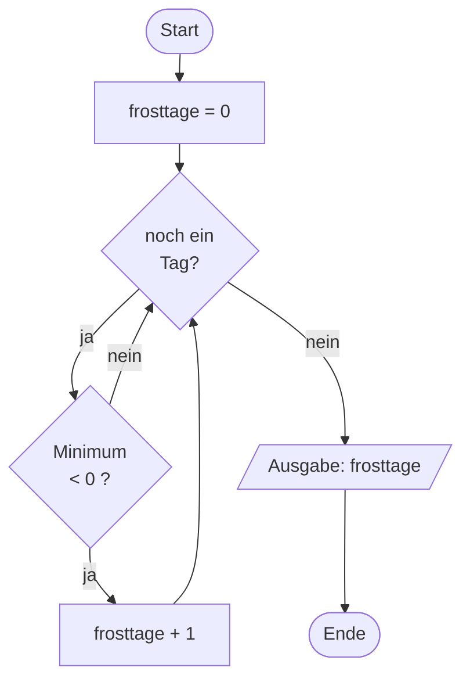

<!--

author:   Sebastian Zug & Bernhard Jung
email:    sebastian.zug@informatik.tu-freiberg.de & bernhard.jung@informatik.tu-freiberg.de
version:  2.3.0
language: de
narrator: Deutsch Female

comment:  Vom Problem zum Programm: Drei Auswertungen mit der Tabellenkalkulation zeigen, wo Handarbeit endet und Algorithmen beginnen.

logo:     ./images/Readme/Wetterstation.png

import:   https://raw.githubusercontent.com/TUBAF-IfI-LiaScript/VL_EAVD/master/config.md
          https://raw.githubusercontent.com/LiaTemplates/mermaid_template/0.1.4/README.md

@style
.flex-container {
    display: flex;
    flex-wrap: wrap;
    align-items: stretch;
    gap: 20px;
}

.flex-child {
    flex: 1;
    min-width: 280px;
}
@end

-->

[](https://liascript.github.io/course/?https://github.com/TUBAF-IfI-LiaScript/VL_EAVD/blob/master/01_VomProblemZumProgramm.md)

# Vom Problem zum Programm

| Parameter                | Kursinformationen                                                                                                                                              |
| ------------------------ | -------------------------------------------------------------------------------------------------------------------------------------------------------------- |
| **Veranstaltung:**       | @config.lecture                                                                                                                                                |
| **Semester**             | @config.semester                                                                                                                                               |
| **Hochschule:**          | `Technische Universität Freiberg`                                                                                                                              |
| **Inhalte:**             | `Tabellenkalkulation an ihren Grenzen, Algorithmusbegriff, Bausteine und Ablaufprotokoll, Tabelle und Skript im Vergleich`                                                                       |
| **Link auf Repository:** | [https://github.com/TUBAF-IfI-LiaScript/VL_EAVD/blob/master/01_VomProblemZumProgramm.md](https://github.com/TUBAF-IfI-LiaScript/VL_EAVD/blob/master/01_VomProblemZumProgramm.md) |
| **Autoren**              | @author                                                                                                                                                        |

--------------------------------------------------------------------------------

**Leitfrage:** _Wo hört die Tabellenkalkulation auf?_

**Fragen an die heutige Veranstaltung ...**

* Welche Auswertungen lassen sich bequem mit einer Tabellenkalkulation erledigen — und welche nicht?
* Was genau macht eine Auswertung "mühsam"?
* Was ist ein Algorithmus, und welche Eigenschaften muss er haben?
* Warum brauchen wir für Algorithmen eine eigene Sprache?

--{{0}}--
Heute schreiben wir noch keine Zeile Code. Wir arbeiten mit einem Werkzeug, das die meisten von Ihnen aus der Schule kennen, und treiben es bewusst an seine Grenzen. Achten Sie dabei weniger auf die Ergebnisse als darauf, an welcher Stelle es mühsam wird. Genau dort beginnt das Programmieren.


> **Bringen Sie heute einen Laptop mit einer Tabellenkalkulation mit** — LibreOffice Calc, Excel oder Google Sheets, egal welche.

> **Zum Nacharbeiten: die Ansicht „Lehrbuch“.** Im Hörsaal zeigen die Folien nur die Kernbotschaften. Die Erklärungen dazu stehen im Lehrbuch: oben rechts auf das Symbol mit den Schiebereglern klicken und „Lehrbuch“ wählen.

--------------------------------------------------------------------------------

## Unsere Datensätze

Wir wollen uns heute einige Datensätze genauer anschauen, diese stammen zum Teil vom Deutschen Wetterdienst (DWD) und unserer Zutrittszählung aus der vergangenen Vorlesung.

Der DWD betreibt auf dem **Fichtelberg** (1213 m, höchster Berg Sachsens) eine Wetterstation. Seit dem **1. August 1890** wird dort jeden Tag gemessen. Die Daten sind frei verfügbar.

In der letzten Vorlesung haben wir den **Personenzähler** an der Hörsaaltür kennengelernt. Er hat aufgeschrieben, wer wann hereinkam und hinausging. Die Daten sind ebenfalls frei verfügbar.

<!-- data-type="none" -->
| Datei                                             | Inhalt                                              | Zeilen  |
| :------------------------------------------------ | :-------------------------------------------------- | ------: |
| `fichtelberg_2024.csv` | ein Jahr, aufbereitet: Datum, Mittel, Minimum, Maximum, abgeschlossener Datensatz | 366     |
| `zaehlungen_2026-10-19.csv` | 31 Durchgänge an einem Vorlesungstag, tagesaktuell | 31 |
| `produkt_klima_tag_…_01358.txt` | alle Tage seit 1890, so wie der DWD sie liefert     | 47.595  |

Alle drei Dateien zum Herunterladen: [`VL01_Daten.zip`](https://github.com/TUBAF-IfI-LiaScript/VL_EAVD/raw/master/examples/01_Tabellenkalkulation/VL01_Daten.zip) (1,1 MB, enthält auch Quellen und Lizenz).

> Quelle: Deutscher Wetterdienst, [Climate Data Center](https://opendata.dwd.de/climate_environment/CDC/observations_germany/climate/daily/kl/historical/), Station 01358, Lizenz [CC BY 4.0](https://creativecommons.org/licenses/by/4.0/).

--{{0}}--
Die Datei für 2024 ist ein Auszug aus der großen DWD-Datei: drei ihrer 19 Spalten, nämlich Tagesmittel, Minimum und Maximum, dazu ein lesbares Datum und Dezimalkommas. So öffnet sie jede Tabellenkalkulation ohne Umwege. Die Zählerdatei haben Sie selbst erzeugt, als Sie letzte Woche durch die Tür gegangen sind. Bei ihr wissen wir also genau, wie die Daten entstanden sind, und auch, was dabei schiefgehen kann.


### Tabellenkalkulation in fünf Begriffen

<!-- data-type="none" -->
| Begriff      | Beispiel                | Bedeutung                                                         |
| :----------- | :---------------------- | :---------------------------------------------------------------- |
| **Zelle**    | `B2`                    | Spalte B, Zeile 2                                                 |
| **Bereich**  | `B2:B367`               | alle Zellen von B2 bis B367                                       |
| **Formel**   | `=B2+B3`                | beginnt mit `=`, das Programm zeigt das Ergebnis an               |
| **Funktion** | `MITTELWERT(B2:B367)`   | fertige Rechenvorschrift mit Namen, die Werte stehen in Klammern  |
| **Bedingung**| `"<0"`                  | in Anführungszeichen: nur Zellen, die sie erfüllen, zählen        |

Mehrere Angaben in der Klammer trennt das deutsche Programm mit Semikolon: `ZÄHLENWENN(C2:C367;"<0")`.

> Die Funktionsnamen hängen von der Sprache Ihres Programms ab. Ist es auf Englisch eingestellt, heißt `MITTELWERT` dort `AVERAGE` und `ZÄHLENWENN` heißt `COUNTIF`.

--{{0}}--
Die Schreibweise B2 kommt daher, dass Spalten Buchstaben und Zeilen Nummern tragen. Der Doppelpunkt in B2:B367 bedeutet „von … bis“. Die Bedingung steht in Anführungszeichen, weil das Programm sie als Text entgegennimmt und erst beim Zählen auswertet. Merken Sie sich die fünf Begriffe: Am Ende der Vorlesung finden Sie jeden von ihnen in Python wieder.


### Ähnlich, aber nicht gleich

Drei verbreitete Tabellenkalkulationen, dieselbe Datei — aber nicht dasselbe Verhalten:

<!-- data-type="none" -->
| | LibreOffice Calc | Microsoft Excel | Google Sheets |
| :-- | :-- | :-- | :-- |
| Kosten, Ort | frei, auf dem Rechner | kostenpflichtig (Microsoft 365), auf dem Rechner | frei mit Google-Konto, im Browser |
| CSV mit `;` öffnen | Importdialog, Semikolon anhaken | Doppelklick genügt meist | _Datei → Importieren_ |
| `2026-10-19T16:15:27` wird zu | Datum mit Uhrzeit | Text | Probieren Sie es aus! |
| Uhrzeit herausholen | `=STUNDE(A2)` | `=TEIL(A2;12;8)` | |
| eigenes Dateiformat | `.ods` (offener Standard) | `.xlsx` | online, Export möglich |

> Eine Formel, die in einem Programm funktioniert, kann im anderen einen Fehler liefern — oder, schlimmer, ein falsches Ergebnis. Wer eine Auswertung weitergibt, muss deshalb auch sagen, **womit** gerechnet wurde.

--{{0}}--
Die Unterschiede entstehen beim Öffnen: Jedes Programm rät, ob ein Eintrag eine Zahl, ein Datum oder Text ist, und jedes rät anders. Dazu kommt die Ländereinstellung. In Deutschland ist das Komma das Dezimalzeichen, deshalb trennen deutsche CSV-Dateien ihre Spalten meist mit einem Semikolon. Das Format `.ods` ist ein offener, international genormter Standard: Jedes Programm darf es lesen und schreiben, ohne von einem einzelnen Hersteller abzuhängen.


## Drei Aufgaben

Wir lösen heute drei Aufgaben — ohne eine Zeile Code. Jede hat ein festes Zeitfenster. Niemand muss alle drei schaffen. Notieren Sie sich bei jeder Aufgabe:

1. Wie weit sind Sie gekommen?
2. Welche Schritte haben Sie **von Hand** ausgeführt?
3. Wie sicher sind Sie, dass Ihr Ergebnis stimmt?

> Die Antworten auf diese drei Fragen sind am Ende wichtiger als die Ergebnisse selbst.

Alle Dateien für heute stecken in [`VL01_Daten.zip`](https://github.com/TUBAF-IfI-LiaScript/VL_EAVD/raw/master/examples/01_Tabellenkalkulation/VL01_Daten.zip) (1,1 MB). Laden Sie die Datei herunter und **entpacken** Sie sie: unter Windows Rechtsklick → „Alle extrahieren …“, unter macOS Doppelklick.

<!-- data-type="none" -->
| Aufgabe | Zeit        | Arbeitsform                 | Ziel                         |
| :------ | ----------: | :-------------------------- | :--------------------------- |
| 1       | 2 + 4 min   | a) vorgemacht, b) allein    | lösen                        |
| 2       |   8 min     | mit Ihrem Nachbarn          | so weit kommen wie möglich   |
| 3       |   4 min     | mit Ihrem Nachbarn          | nicht lösen — nur hinschauen |

> Noch nie mit einer Tabellenkalkulation gearbeitet? Kein Problem: Aufgabe 1 a) machen wir gemeinsam, und unter jeder Aufgabe gibt es Hilfen zum Aufklappen.

--{{0}}--
Die Zeitfenster sind bewusst knapp. Es geht nicht darum, alle Aufgaben zu lösen, sondern zu bemerken, wie sich der Aufwand von Aufgabe zu Aufgabe verändert. Ihre Notizen zu den drei Fragen brauchen wir im Abschnitt „Was ist hier passiert?“. Dort vergleichen wir die Aufgaben.


### Aufgabe 1: Ein Jahr auf dem Fichtelberg

                                     {{0-1}}
*******************************************************************************

Öffnen Sie `fichtelberg_2024.csv` aus [`VL01_Daten.zip`](https://github.com/TUBAF-IfI-LiaScript/VL_EAVD/raw/master/examples/01_Tabellenkalkulation/VL01_Daten.zip) in Ihrer Tabellenkalkulation.

```text fichtelberg_2024.csv
Datum;Tagesmittel;Minimum;Maximum
2024-01-01;-1,2;-1,9;-0,7
2024-01-02;-0,5;-2,4;2,6
2024-01-03;1,6;0,1;2,5
...
```

> [!NOTE] ❓ Aufgabe
>
> **a)** Wie hoch war die mittlere Temperatur im Jahr 2024?
>
> **b)** **⏱ 4 Minuten, allein.** An wie vielen Tagen gab es Frost? Ein **Frosttag** ist ein Tag, an dem das _Minimum_ unter 0 °C lag.

<details>
<summary>**Hilfe: Die Datei öffnen**</summary>

* **LibreOffice Calc:** Datei öffnen, im Dialog „Textimport“ **nur** das Trennzeichen **Semikolon** anhaken, **Komma** nicht — sonst wird `-1,2` in zwei Spalten `-1` und `2` zerlegt. OK.
* **Excel:** Doppelklick auf die Datei genügt meist. Steht alles in Spalte A: _Daten → Text in Spalten_, Trennzeichen Semikolon.
* **Google Sheets:** _Datei → Importieren → Hochladen_, Trennzeichen „Semikolon“ wählen.

Richtig geöffnet stehen Datum, Tagesmittel, Minimum und Maximum in den Spalten A bis D, und die Zahlen sind **rechtsbündig**. Linksbündige Zahlen hält das Programm für Text.

</details>

<details>
<summary>**Hilfe: Die Formel**</summary>

Die Funktion heißt `ZÄHLENWENN`. Sie braucht zwei Angaben: den Bereich mit den Minima (Spalte C) und die Bedingung „kleiner als 0“.

</details>

--{{0}}--
Aufgabe a) mache ich vor: Datei öffnen, prüfen, ob die Zahlen rechtsbündig stehen, dann eine Formel in eine freie Zelle schreiben. Für b) brauchen Sie dieselben Schritte mit einer anderen Funktion.


*******************************************************************************

                                     {{1}}
*******************************************************************************

**Lösung**

```text
a)  =MITTELWERT(B2:B367)          →   6,26 °C
b)  =ZÄHLENWENN(C2:C367;"<0")     →   127 Tage
```

Die mittlere Temperatur im Jahr 2024 betrug [[ 1,2 °C | 4,1 °C | (6,3 °C) | 9,8 °C ]].

> **Leicht.** Eine Datei, saubere Spalten, eine Formel pro Frage. Genau dafür wurden Tabellenkalkulationen gebaut.

Lösung zum Nachschauen: [`Aufgabe1_Fichtelberg_Loesung.ods`](https://github.com/TUBAF-IfI-LiaScript/VL_EAVD/raw/master/examples/01_Tabellenkalkulation/Aufgabe1_Fichtelberg_Loesung.ods)

--{{1}}--
2024 war ein Schaltjahr, deshalb reichen die Daten bis Zeile 367: eine Kopfzeile und 366 Tage. An 127 Tagen, also etwa an jedem dritten, lag das Minimum unter 0 °C. Für den Fichtelberg ist das sogar wenig: Im Mittel der 2010er-Jahre waren es rund 154 Frosttage.


*******************************************************************************

### Aufgabe 2: Der Personenzähler

                                     {{0-2}}
*******************************************************************************

Erinnern Sie sich an den Personenzähler aus der letzten Vorlesung? Der Roboter an der Hörsaaltür hat aufgeschrieben, wer wann hereinkam und hinausging:

```text zaehlungen_2026-10-19.csv
zeit;richtung
2026-10-19T16:14:06;rein
2026-10-19T16:14:22;unklar
2026-10-19T16:15:27;rein
2026-10-19T16:15:30;raus
2026-10-19T16:16:43;rein
...
```

Die Vorlesung begann um 16:15 Uhr.

**⏱ 8 Minuten, mit Ihrem Nachbarn.** Öffnen Sie `zaehlungen_2026-10-19.csv` aus [`VL01_Daten.zip`](https://github.com/TUBAF-IfI-LiaScript/VL_EAVD/raw/master/examples/01_Tabellenkalkulation/VL01_Daten.zip).

> [!NOTE] ❓ Aufgabe
> 
> **a)** Wie viele Personen sind **nach** Vorlesungsbeginn gekommen?
> 
> **b)** _(zu Hause)_ In welcher Minute kamen die meisten?

Sie müssen nicht fertig werden. Merken Sie sich die Stelle, an der Sie hängen bleiben.

<details>
<summary>**Hilfe: Die Uhrzeit aus dem Zeitstempel holen**</summary>

Je nach Programm steht in Spalte A danach ein **Datum mit Uhrzeit** (rechtsbündig) oder **Text** (linksbündig):

* Datum mit Uhrzeit: `=STUNDE(A2)` und `=MINUTE(A2)` liefern die Teile.
* Text: `=TEIL(A2;12;8)` schneidet ab dem 12. Zeichen acht Zeichen heraus, also `16:14:06`. `ZEITWERT(…)` macht daraus eine Uhrzeit, mit der man vergleichen kann.

</details>

<details>
<summary>**Hilfe: Mit zwei Bedingungen zählen**</summary>

`ZÄHLENWENNS` zählt Zeilen, die **alle** Bedingungen erfüllen, z. B. „Richtung ist `rein`“ **und** „Uhrzeit ab 16:15“. Eine Uhrzeit als Bedingung: `">="&ZEIT(16;15;0)`.

</details>

--{{0}}--
Der Roboter misst mit einem Abstandssensor, ob jemand vor ihm steht. Aus der Reihenfolge, in der seine Messzonen ansprechen, schließt er auf die Richtung. Gelingt das nicht eindeutig, notiert er „unklar“. Jede Zeile der Datei ist also schon eine Entscheidung seines Programms, nicht die Messung selbst.


*******************************************************************************

                                     {{1}}
*******************************************************************************

**Was dabei zu tun ist**

1. Datei importieren, Trennzeichen ist das Semikolon.
2. Aus `2026-10-19T16:15:27` eine Uhrzeit machen, mit der man vergleichen kann.
3. Entscheiden: Was zählt — nur `rein`? Und was ist mit `unklar`?
4. Wer kurz hinaus- und wieder hereingeht, steht zweimal in der Datei.
5. Minuten bilden und zählen.

<details>
<summary>**Lösung**</summary>

**a)** Ab 16:15 stehen 8 × `rein`, 2 × `raus` und 2 × `unklar` in der Datei. Je nach Regel kamen also 6 bis 10 Personen zu spät. Um 16:15:27 hinein und 16:15:30 wieder hinaus — das war vermutlich dieselbe Person.

**b)** Um 16:10 mit 6 × `rein`. Wer `unklar` mitzählt, findet um 16:12 ebenfalls 6 Durchgänge.

Zum Nachschauen: [`Aufgabe2_Personenzaehler_Loesung.ods`](https://github.com/TUBAF-IfI-LiaScript/VL_EAVD/raw/master/examples/01_Tabellenkalkulation/Aufgabe2_Personenzaehler_Loesung.ods)

</details>

> **Mühsam.** Die eigentliche Frage ist einfach. Der Aufwand steckt darin, die Daten in eine Form zu bringen, mit der die Tabellenkalkulation umgehen kann.
>
> Und nächste Woche liefert der Roboter die nächste Datei. Dann beginnt alles von vorn.

--{{1}}--
Keiner der fünf Schritte ist schwer. Aufwendig wird es, weil jeder eine Entscheidung verlangt, die nirgends festgehalten wird: Welche Regel gilt für „unklar“? Zählt die Person doppelt, die kurz hinausging? Wer die Auswertung nächste Woche wiederholt, muss sich an all das erinnern.


*******************************************************************************

                                     {{2}}
*******************************************************************************

**Und wie viele waren nun da?** Der Zähler kommt auf 20 × `rein` und 3 × `raus`, also 17 Personen im Raum. Laut Umfrage in der letzten Vorlesung waren es 41.

> Die Aufzeichnung begann um 16:08. Wer früher kam — und das waren viele von Ihnen —, steht nicht in der Datei. **Das Programm hat richtig gezählt. Es konnte nur nicht zählen, was es nicht gesehen hat.**

--{{2}}--
Einen Teil der Lücke erklärt der Start der Aufzeichnung um 16:08. Ein anderer kann am Sensor selbst liegen: Gehen zwei Personen dicht hintereinander durch die Tür, sieht er womöglich nur eine. Solche Annahmen stecken in jeder Messung, auch in denen des DWD.


*******************************************************************************

### Aufgabe 3: 135 Jahre Frost

                                     {{0-2}}
*******************************************************************************

Jetzt die Datei, wie der DWD sie tatsächlich liefert:

```text produkt_klima_tag_18900801_20251231_01358.txt
STATIONS_ID;MESS_DATUM;QN_3;  FX;  FM;QN_4; RSK;RSKF; SDK;SHK_TAG;  NM; VPM;  PM; TMK; UPM; TXK; TNK; TGK;eor
       1358;18900801;-999;-999;-999;    1;   0.0;   0;-999;-999;   2.0;  13.2;    -999;   15.6;   67.00;   19.6;   10.0;-999;eor
       1358;18900802;-999;-999;-999;    1;  19.8;   1;-999;-999;   4.3;  13.5;    -999;   17.4;   61.00;   22.5;   10.8;-999;eor
...
```

**⏱ 4 Minuten, zu zweit.** Öffnen Sie die Datei des DWD, `produkt_klima_tag_…_01358.txt` aus [`VL01_Daten.zip`](https://github.com/TUBAF-IfI-LiaScript/VL_EAVD/raw/master/examples/01_Tabellenkalkulation/VL01_Daten.zip).

[Datensatzbeschreibung des DWD](https://opendata.dwd.de/climate_environment/CDC/observations_germany/climate/daily/kl/BESCHREIBUNG_obsgermany-climate-daily-kl_de.pdf)

> [!NOTE] ❓ Aufgabe
>
> _Wie hat sich die Zahl der Frosttage pro Jahr seit 1890 entwickelt?_
>
> Lösen Sie die Frage **nicht**. Sammeln Sie stattdessen: Was müssten Sie alles tun, um sie zu beantworten?

--{{0}}--
Die Spaltennamen sind Abkürzungen des DWD. TMK ist das Tagesmittel der Lufttemperatur in 2 m Höhe, TNK das Tagesminimum, TXK das Tagesmaximum. TGK ist ebenfalls ein Minimum, aber 5 cm über dem Erdboden gemessen, und damit eine Falle für alle, die nur nach „Minimum“ suchen. Was jede Spalte bedeutet, steht in der Datensatzbeschreibung.


*******************************************************************************

                                     {{1}}
*******************************************************************************

**Worüber Sie dabei stolpern**

* 47.595 Zeilen und 19 Spalten, von denen Sie zwei brauchen: `MESS_DATUM` (das Datum) und `TNK` (die tiefste Temperatur des Tages in °C)
* Dezimalpunkt statt Dezimalkomma — je nach Einstellung wird aus `-0.5` der 5. Januar
* `-999` steht für "nicht gemessen" und ist sicher kein Frost
* Das Datum `18900801` ist eine Zahl, kein Datum. Das Jahr steckt in den ersten vier Ziffern.
* 1890 beginnt im August, zwischen 1910 und 1915 fehlen fast fünf Jahre
* Danach: 135 Jahre, für jedes eine eigene `ZÄHLENWENNS`-Formel

> **Praktisch aussichtslos** — zumindest, wenn das Ergebnis stimmen soll. Und wenn Ihre Betreuerin danach fragt, wie es auf der Zugspitze aussieht, fangen Sie wieder von vorn an.

--{{1}}--
Aus -0.5 wird ein Datum, weil eine deutsch eingestellte Tabellenkalkulation den Punkt nicht als Dezimalzeichen kennt und die Eingabe stattdessen als Tag und Monat deutet. Das geschieht ohne Warnung; man bemerkt es erst, wenn ein Ergebnis seltsam aussieht. Bei dieser Datei muss man also erst die Daten in Form bringen, bevor die eigentliche Frage überhaupt beginnt.


*******************************************************************************

## Was ist hier passiert?

                                     {{0-1}}
*******************************************************************************

Vergleichen Sie die drei Aufgaben. Aufgabe 1b und Aufgabe 3 stellen sogar dieselbe **Frage**: _Wie viele Tage lag das Minimum unter 0 °C?_ Geändert haben sich nur die Umstände:

<!-- data-type="none" -->
| Was sich ändert                | Aufgabe 1          | Aufgabe 2         | Aufgabe 3               |
| :----------------------------- | :----------------- | :---------------- | :---------------------- |
| Datenmenge                     | 366 Zeilen         | 31 Zeilen         | 47.595 Zeilen           |
| Spalten                        | 4                  | 2                 | 19, davon zwei gebraucht |
| Format                         | sauber             | Zeitstempel als Text | Rohformat mit Fehlwerten |
| Wie oft dieselbe Rechnung      | einmal             | einmal pro Minute | einmal pro Jahr (135×)  |
| Wiederholbar mit neuen Daten?  | ja                 | nein              | nein                    |

> [!TIP]
> Spannendere Möglichkeiten wie Pivot-Tabellen, Diagramme, Filter, Sortieren, Suchen, Ersetzen, Text in Spalten, bedingte Formatierung, Makros und Skripte lassen wir heute außen vor. Sie sind nicht nötig, um die Frage zu beantworten.

--{{0}}--
Die Fähigkeiten der Tabellenkalkulation sind nicht das Problem. Das Problem ist, dass jeder Schritt von Hand ausgeführt und für jede neue Datei wiederholt werden muss. Aufgabe 1 wäre mit einem Programm kaum schneller gelöst, Aufgabe 3 dagegen sehr wohl.


*******************************************************************************

                                     {{1}}
*******************************************************************************

Was in Aufgabe 3 fehlte, war jemand, der **dieselben Schritte beliebig oft, fehlerfrei und ohne Murren** ausführt:

``` text
Für jedes Jahr von 1890 bis 2025:
    Setze den Zähler auf 0.
    Für jede Zeile, deren MESS_DATUM mit diesem Jahr beginnt:
        Wenn TNK nicht -999 ist und unter 0 liegt:
            Erhöhe den Zähler um 1.
    Notiere Jahr und Zähler.
```

Diese Handlungsvorschrift ist unabhängig davon, ob es um 7 oder 47.595 Tage geht. Genau so etwas nennt man einen **Algorithmus**.

--{{1}}--
Der Pseudocode enthält keine einzige Zahl aus der Datei. Er beschreibt nur, was mit jeder Zeile geschehen soll. Deshalb funktioniert er für den Fichtelberg genauso wie für die Zugspitze, für 135 Jahre genauso wie für eine Woche.


*******************************************************************************

## Algorithmen

> Ein **Algorithmus** ist eine eindeutige Handlungsvorschrift, die aus endlich vielen, ausführbaren Einzelschritten besteht und für **jede passende Eingabe** nach endlich vielen Schritten ein **Ergebnis** liefert.

Algorithmen begegnen Ihnen ständig: ein Kochrezept, eine Aufbauanleitung, eine Versuchsvorschrift im Labor. Damit ein **Rechner** sie ausführen kann, müssen sie aber strenge Anforderungen erfüllen:

<!-- data-type="none" -->
| Eigenschaft        | Bedeutung                                          | Verletzt durch ...                           |
| :----------------- | :------------------------------------------------- | :------------------------------------------- |
| **Eindeutigkeit**  | Jeder Schritt lässt genau eine Auslegung zu        | "Erhöhe den Zähler, wenn es kalt war"        |
| **Ausführbarkeit** | Jeder Schritt kann tatsächlich ausgeführt werden   | "Teile die Zahl der Frosttage durch 0"       |
| **Endlichkeit**    | Die Beschreibung hat endlich viele Schritte        | "Und so weiter ..."                          |
| **Terminierung**   | Die Ausführung endet nach endlich vielen Schritten | "Erhöhe den Zähler um 1, bis er negativ ist" |

--{{0}}--
Das Wort geht auf den persischen Mathematiker al-Chwarizmi zurück, der im 9. Jahrhundert ein Lehrbuch über das Rechnen mit indischen Ziffern schrieb. In der lateinischen Übersetzung wurde aus seinem Namen „Algorismi“. Ein Kochrezept erfüllt die vier Eigenschaften übrigens selten: „eine Prise Salz“ ist für einen Menschen eindeutig genug, für einen Rechner nicht.


### Warum der Rechner keine Alltagssprache versteht

                                     {{0-1}}
*******************************************************************************

> _"Zähl mal die kalten Tage."_

Was ist "kalt"? Unter 0 °C? Unter 5 °C? Das Tagesmittel oder das Minimum? Und was ist mit den Tagen, an denen gar nicht gemessen wurde?

Ein Mensch fragt nach oder entscheidet nach Gefühl. Ein Rechner kann beides nicht:

* Er hat **kein Weltwissen** und keine Erfahrung.
* Er **rät nicht** und liest nicht zwischen den Zeilen.
* Er führt **exakt** das aus, was dasteht — auch wenn es Unsinn ist.

--{{0}}--
Das ist kein Mangel, sondern eine Stärke: Weil der Rechner nichts dazudenkt, liefert er bei gleicher Eingabe immer dasselbe Ergebnis. Und jede Entscheidung, die im Programm steht, kann jemand anderes nachlesen und prüfen.


*******************************************************************************

                                     {{1}}
*******************************************************************************

Programmiersprachen sind deshalb ein Kompromiss:

<!-- data-type="none" -->
| Alltagssprache             | Programmiersprache      | Maschinensprache          |
| :------------------------- | :---------------------- | :------------------------ |
| "Zähl die kalten Tage"     | `if minimum < 0:`       | `01011010 11001001 ...`   |
| mehrdeutig                 | eindeutig               | eindeutig                 |
| für Menschen leicht        | für Menschen lesbar     | für Menschen unlesbar     |
| für Rechner unbrauchbar    | für Rechner übersetzbar | für Rechner direkt ausführbar |

> Eine Programmiersprache ist **die Sprache, in der man einen Algorithmus so aufschreibt, dass sowohl Menschen als auch Rechner ihn verstehen.**

--{{1}}--
Den Schritt von der Programmiersprache zur Maschinensprache übernimmt ein eigenes Programm. Bei Python heißt es Interpreter: Er liest Ihr Programm Zeile für Zeile und führt es aus. Ihn lernen Sie nächste Woche kennen.


*******************************************************************************

### Algorithmen darstellen

Bevor man programmiert, hilft es, den Algorithmus aufzuschreiben — noch ohne sich um die Regeln einer Sprache zu kümmern.

<div class="flex-container">
<div class="flex-child">

**Pseudocode**

``` text
Setze frosttage auf 0.
Für jedes Minimum in der Liste:
    Wenn Minimum < 0:
        Erhöhe frosttage um 1.
Gib frosttage aus.
```

</div>
<div class="flex-child">

**Ablaufdiagramm**



</div>
</div>

> In zwei Wochen schreiben Sie genau diesen Algorithmus in Python. Er wird **fünf Zeilen** lang sein.

--{{0}}--
Für Pseudocode gibt es keine festen Regeln. Wichtig ist nur, dass jeder Schritt eindeutig ist und die Einrückung zeigt, was wozu gehört. Für Ablaufdiagramme gibt es dagegen eine Norm, die DIN 66001; sie legt zum Beispiel fest, dass eine Raute für eine Entscheidung steht. Beide Darstellungen beschreiben denselben Algorithmus. Wählen Sie die, mit der Sie besser denken können.


### Drei Bausteine

Jeder Algorithmus, auch der für 135 Jahre, setzt sich aus nur drei Bausteinen zusammen:

<!-- data-type="none" -->
| Baustein         | Bedeutung                                 | im Frosttage-Algorithmus         | in Python |
| :--------------- | :---------------------------------------- | :------------------------------- | :-------- |
| **Folge**        | Schritte nacheinander ausführen           | erst „Setze …“, am Ende „Gib …“  | VL 02     |
| **Verzweigung**  | einen Schritt nur unter einer Bedingung   | „Wenn Minimum < 0“               | VL 03     |
| **Wiederholung** | Schritte für jedes Element wiederholen    | „Für jedes Minimum“              | VL 03     |

Im Ablaufdiagramm erkennt man sie an der Form: Pfeile von Kasten zu Kasten bilden eine Folge, eine Raute mit _ja_ und _nein_ eine Verzweigung, ein Pfeil, der zurückführt, eine Wiederholung.

--{{0}}--
Dass diese drei Bausteine genügen, ist bewiesen: Corrado Böhm und Giuseppe Jacopini haben 1966 gezeigt, dass sich jeder Algorithmus aus Folge, Verzweigung und Wiederholung zusammensetzen lässt. Python bietet mehr, und das erleichtert das Schreiben. Nötig ist es nicht.


### Einen Algorithmus von Hand ausführen

Bevor ein Rechner einen Algorithmus ausführt, sollte man es einmal selbst tun — mit Stift, Papier und wenigen Werten. Hier die Tiefsttemperaturen der ersten sieben Tage 2024 in °C:

`-1,9   -2,4   0,1   -1,7   -1,7   -4,2   -11,9`

Gehen Sie den Pseudocode aus dem letzten Abschnitt Tag für Tag durch und notieren Sie nach jedem Tag den Wert von `frosttage`. Was wird ausgegeben?

[[6]]
***
<!-- data-type="none" -->
| Tag | Minimum | Minimum < 0? | frosttage |
| --: | ------: | :----------: | --------: |
|     |         |              |         0 |
|   1 |    -1,9 | ja           |         1 |
|   2 |    -2,4 | ja           |         2 |
|   3 |     0,1 | nein         |         2 |
|   4 |    -1,7 | ja           |         3 |
|   5 |    -1,7 | ja           |         4 |
|   6 |    -4,2 | ja           |         5 |
|   7 |   -11,9 | ja           |         6 |

Eine solche Tabelle heißt **Ablaufprotokoll**. Sie zeigt nicht nur das Ergebnis, sondern jeden Zwischenstand.
***

Jetzt ist beim Abschreiben eine Zeile verrutscht:

``` text
Für jedes Minimum in der Liste:
    Setze frosttage auf 0.
    Wenn Minimum < 0:
        Erhöhe frosttage um 1.
Gib frosttage aus.
```

Legen Sie sich fest, **bevor** Sie die Auflösung ansehen: Was wird für die sieben Tage ausgegeben?

[( )] 6
[(X)] 1
[( )] 0
[( )] nichts, der Algorithmus ist fehlerhaft
***
Der Zähler wird an **jedem** Tag auf 0 zurückgesetzt. Am Ende zählt nur der letzte Tag: -11,9 °C, also 1. Der Algorithmus ist eindeutig und ausführbar, er beantwortet nur eine andere Frage als gemeint.
***

--{{0}}--
Ein Ablaufprotokoll ist das wichtigste Werkzeug, um einen Algorithmus zu verstehen, bevor er läuft. Sie werden es das ganze Semester brauchen, auch in der Klausur. Der verrutschte Zähler ist dabei kein konstruierter Fehler: Den Startwert innerhalb der Wiederholung zu setzen, gehört zu den häufigsten Fehlern in ersten Programmen.


### Typische Fehlvorstellung: Kein Fehler heißt richtiges Ergebnis

> **Typische Fehlvorstellung:** _„Wenn der Rechner keine Fehlermeldung zeigt, stimmt das Ergebnis.“_

Zurück zum Algorithmus für 135 Jahre:

``` text
Für jedes Jahr von 1890 bis 2025:
    Setze den Zähler auf 0.
    Für jede Zeile, deren MESS_DATUM mit diesem Jahr beginnt:
        Wenn TNK nicht -999 ist und unter 0 liegt:
            Erhöhe den Zähler um 1.
    Notiere Jahr und Zähler.
```

Für die Jahre 1911 bis 1914 enthält die Datei des DWD keine einzige Zeile.

Legen Sie sich fest, **bevor** Sie die Auflösung ansehen: Was notiert der Algorithmus für das Jahr 1912?

[( )] eine Fehlermeldung, weil es keine Daten gibt
[( )] nichts, das Jahr wird übersprungen
[(X)] 1912 und 0
[( )] ungefähr 180, wie in den Jahren davor
***
Die äußere Wiederholung läuft über **alle** Jahre von 1890 bis 2025, also auch über 1912. Die innere findet keine Zeile, deren `MESS_DATUM` mit 1912 beginnt, und läuft kein einziges Mal. Der Zähler bleibt bei 0, und genau das wird notiert — ohne Warnung.

In einem Diagramm wäre 1912 das Jahr ohne Frost auf dem Fichtelberg. Das frostärmste Jahr, das tatsächlich vollständig gemessen wurde, ist 2025 mit 122 Frosttagen. Dasselbe Problem in kleinerem Maßstab: 1890 kommt auf nur 58 Frosttage, weil die Messungen erst am 1. August beginnen.
***

> Ein Rechner prüft nicht, ob ein Ergebnis Sinn ergibt. Das bleibt Ihre Aufgabe — hier zum Beispiel, indem der Algorithmus auch mitzählt, **wie viele Tage überhaupt gemessen wurden**.

--{{0}}--
Dasselbe haben Sie in Aufgabe 2 erlebt: Der Personenzähler hat richtig gezählt und trotzdem 17 statt 41 Personen gemeldet. Ob ein Ergebnis stimmt, entscheidet nicht der Rechner, sondern der Abgleich mit dem, was man über die Daten weiß. In Vorlesung 09 suchen wir solche Lücken systematisch, in Vorlesung 14 fragen wir, wann man einem Ergebnis trauen kann.


## Wann lohnt sich ein Programm?

Die Tabellenkalkulation ist ein hervorragendes Werkzeug. Ein Programm lohnt sich, wenn mindestens eines davon zutrifft:

<!-- data-type="none" -->
| Merkmal                      | Beispiel                                                       |
| :--------------------------- | :------------------------------------------------------------- |
| **Viele Daten**              | 47.595 Zeilen, oder 500 Dateien                                |
| **Sperrige Formate**         | Sensorprotokolle, Rohdaten mit Fehlwerten, gemischte Einheiten |
| **Wiederholung**             | jede Woche neue Messdaten, dieselbe Auswertung                 |
| **Nachvollziehbarkeit**      | Jemand anderes soll prüfen können, was genau Sie gerechnet haben |

> Der letzte Punkt wird oft unterschätzt. Eine Tabelle mit 135 von Hand angepassten Formeln kann niemand prüfen — ein Programm von zehn Zeilen schon.

--{{0}}--
Die Liste ist eine Entscheidungshilfe, keine Pflicht. Für eine einmalige Auswertung einer sauberen Datei bleibt die Tabellenkalkulation oft die schnellere Wahl. Trifft aber eines der Merkmale zu, wächst der Aufwand von Hand mit jeder neuen Datei, der eines Programms dagegen kaum.


### Tabellenkalkulation und Skript im Vergleich

Tabellenkalkulation und Skript sind nicht nur zwei Werkzeuge, sondern zwei Arten, über eine Auswertung zu denken:

<!-- data-type="none" -->
| Frage                          | Tabellenkalkulation                        | Skript                                        |
| :----------------------------- | :----------------------------------------- | :-------------------------------------------- |
| Wo stehen Daten und Rechnung?  | gemeinsam in den Zellen                    | getrennt: Daten in einer Datei, Rechnung im Skript |
| Was sieht man?                 | die Ergebnisse, die Formeln stecken dahinter | die Rechenschritte, Ergebnisse entstehen beim Ausführen |
| Import, Filtern, Kopieren      | wird nirgends festgehalten                 | ist Teil des Skripts                          |
| Neue Daten                     | alle Schritte noch einmal von Hand         | Skript erneut starten                         |
| Prüfen                         | Zelle für Zelle anklicken                  | den Text von oben nach unten lesen            |
| Änderungen nachverfolgen       | Kopien wie `Auswertung_final_v3.xlsx`      | Versionsverwaltung: jede Änderung Zeile für Zeile, mit Datum und Grund |
| Stärke                         | sofort sichtbar, schnell ausprobiert       | wiederholbar, nachvollziehbar, beliebig groß  |

> In der Tabellenkalkulation **ist** die Tabelle das Ergebnis. Beim Skript ist das Ergebnis ein Nebenprodukt — was bleibt, ist der Weg dorthin.

--{{0}}--
Eine Versionsverwaltung ist ein Programm, das jeden gespeicherten Stand einer Datei aufhebt, wie ein Notizbuch, in das man bei jeder Änderung schreibt, was man geändert hat und warum. Bei einem Skript funktioniert das besonders gut, weil es reiner Text ist: Man sieht genau, welche Zeile sich geändert hat. Die Vorlesungsfolien entstehen übrigens genauso, mit der Versionsverwaltung Git auf GitHub. Excel und Google Sheets heben zwar ebenfalls ältere Stände auf, welche Formel sich zwischen zwei Ständen geändert hat, muss man dort aber Zelle für Zelle suchen.

Wie riskant Handarbeit ist, die nirgends festgehalten wird, zeigt die Genetik: Tabellenkalkulationen machen aus Gennamen wie `SEPT2` oder `MARCH1` beim Öffnen stillschweigend ein Datum. Eine Untersuchung fand 2016 solche Fehler in etwa jeder fünften Veröffentlichung, die Genlisten als Excel-Datei mitlieferte. 2020 wurden die betroffenen Gene deshalb umbenannt: `SEPT2` heißt heute `SEPTIN2`.

### Ist das schon programmieren?

Ein Stück weit, ja: Jede Formel ist ein kleines Programm. Was Sie heute in die Zellen geschrieben haben, gibt es in Python wieder, nur unter anderem Namen.

<!-- data-type="none" -->
| Tabellenkalkulation      | Python                       | heißt dort                   |
| :----------------------- | :--------------------------- | :--------------------------- |
| Zelle `C2`               | `minimum = -1.9`             | Variable (VL 02)             |
| Bereich `C2:C367`        | `minima = [-1.9, -2.4, 0.1]` | Liste (VL 03, 05)            |
| `MITTELWERT(C2:C367)`    | `sum(minima) / len(minima)`  | Funktion (VL 02, 04)         |
| `WENN(C2<0; 1; 0)`       | `if minimum < 0:`            | Verzweigung (VL 03)          |
| Formel nach unten ziehen | `for minimum in minima:`     | Wiederholung (VL 03)         |

Wie viele der zwölf Zahlen in [`Loop.ods`](https://github.com/TUBAF-IfI-LiaScript/VL_EAVD/raw/master/examples/01_Tabellenkalkulation/Loop.ods) sind kleiner als 0? In der Tabelle: Bedingung in B2, nach unten ziehen, zusammenzählen. In Python:

```python
zahlen = [-3, -3, 4, 8, -8, -5, 6, -8, 7, -4, 4, -2]
anzahl = 0
for zahl in zahlen:            # Formel nach unten ziehen
    if zahl < 0:               # =WENN(A2<0; 1; 0)
        anzahl = anzahl + 1
print(anzahl)                  # =SUMME(B2:B13)
```

--{{0}}--
Beim Herunterziehen passt die Tabellenkalkulation den Bezug in jeder Zeile an: Aus A2 wird A3, dann A4 und so weiter. Am Ende stehen zwölf Kopien derselben Formel in der Tabelle. Die Schleife schreibt die Regel dagegen nur einmal hin, und `zahl` nimmt nacheinander jeden Wert der Liste an. Ob es zwölf oder 47.595 Zahlen sind, ändert am Programm nichts.


> Die Python-Spalte müssen Sie heute nicht verstehen; sie begegnet Ihnen in den nächsten Wochen. Einer der drei Bausteine fehlt in der Tabelle allerdings: die **Folge**, also eine feste Reihenfolge der Schritte.

### Eingabengetrieben oder der Reihe nach

<!-- data-type="none" -->
| Frage                   | Tabellenkalkulation                    | Skript                                    |
| :---------------------- | :------------------------------------- | :---------------------------------------- |
| Wann wird gerechnet?    | sobald sich eine Eingabe ändert        | wenn Sie das Skript starten               |
| In welcher Reihenfolge? | legt das Programm anhand der Bezüge fest | Zeile für Zeile, wie Sie sie geschrieben haben |
| Welcher Wert gilt?      | immer der neueste Stand                | der, den die Zeilen davor festgelegt haben |

> Im Skript wissen Sie bei jeder Zeile, **was schon geschehen ist und was noch nicht**. Die Tabellenkalkulation ist **eingabengetrieben**: Sie hat keinen Ablauf, nur Abhängigkeiten.

--{{0}}--
B1 hängt von A1 ab. Ändern Sie A1, verfolgt das Programm alle Bezüge und rechnet die betroffenen Zellen neu, in einer Reihenfolge, die Sie nicht sehen und nicht bestimmen. Zum Ausprobieren ist das bequem. Für eine Auswertung heißt es aber: Es gibt keinen Zeitpunkt, an dem man sagen kann „dieser Schritt ist erledigt, jetzt kommt der nächste“. Im Skript gibt es ihn. Deshalb konnten Sie den Frosttage-Algorithmus vorhin von Hand ausführen und nach jedem Schritt notieren, welcher Wert gerade gilt.

In Zelle A1 steht `3`, in Zelle B1 die Formel `=A1*2`. Sie ändern A1 auf `5`. Was steht jetzt in B1?

[[10]]
***
Die Tabellenkalkulation rechnet nach, sobald sich A1 ändert. Merken Sie sich diese Erwartung: Nächste Woche sehen Sie, dass sich ein Skript an dieser Stelle anders verhält.
***

### Ein Blick voraus

So sieht die Lösung von Aufgabe 3 in Vorlesung 12 aus:

```python
import pandas as pd
# Einlesen, Spalten trennen, fehlende Werte als NaN markieren
df = pd.read_csv("produkt_klima_tag_18900801_20251231_01358.txt",
                 sep=";", skipinitialspace=True, na_values=-999)
# Jahr aus dem Datum extrahieren
df["Jahr"] = df["MESS_DATUM"] // 10000
# Zählen der Frosttage pro Jahr
print((df["TNK"] < 0).groupby(df["Jahr"]).sum())
```

Vier Anweisungen. Sie müssen heute noch keine davon verstehen. Sie zählen die Frosttage jedes Jahres; für das Diagramm unten kommen noch zwei Schritte dazu: unvollständig gemessene Jahre aussortieren und je Jahrzehnt mitteln.

<!-- data-type="barchart" data-show data-title="Mittlere Zahl der Frosttage pro Jahr, Fichtelberg" data-xlabel="Jahrzehnt" data-ylabel="Frosttage" -->
| Jahrzehnt | Frosttage |
| :-------- | --------: |
| 1890er    |     177.6 |
| 1900er    |     189.8 |
| 1910er    |     186.5 |
| 1920er    |     182.6 |
| 1930er    |     178.4 |
| 1940er    |     174.4 |
| 1950er    |     179.1 |
| 1960er    |     169.4 |
| 1970er    |     175.3 |
| 1980er    |     169.4 |
| 1990er    |     165.9 |
| 2000er    |     156.6 |
| 2010er    |     154.2 |
| 2020er    |     140.0 |

> Rund 40 Frosttage weniger als in den 1920er-Jahren — wobei die 2020er erst sechs Jahre umfassen. Bevor wir so etwas behaupten, werden wir aber prüfen müssen, ob die Zahlen das tragen — was ist mit den Lücken, und stand das Thermometer immer an derselben Stelle? Dazu mehr in Vorlesung 14.

--{{0}}--
Für das Diagramm zählen nur Jahre mit mindestens 360 gemessenen Tagen. Damit fallen 1890 und 1891 heraus, ebenso die Jahre rund um die Lücke von 1910 bis 1915. Jede Säule ist ein Mittelwert, keine Summe; sonst sähen die 2020er mit ihren sechs Jahren nach einem Absturz aus, den es nicht gibt. Solche Regeln gehören zum Ergebnis dazu: Wer sie weglässt, erzählt eine andere Geschichte.


## Kontrollfragen

> Zum Nacharbeiten nach der Vorlesung.

Welche Eigenschaft eines Algorithmus verletzt die Anweisung _"Addiere alle Temperaturen, die ungefähr gleich sind"_?

[( )] Endlichkeit
[(X)] Eindeutigkeit
[( )] Terminierung
[( )] Ausführbarkeit
***
"Ungefähr gleich" lässt verschiedene Auslegungen zu: 0,1 °C Unterschied? 1 °C? Ein Rechner braucht eine exakte Grenze.
***

Welche der folgenden Anweisungen sind als Schritt eines Algorithmus für einen Rechner geeignet?

[[X]] Wenn das Minimum kleiner als 0 °C ist, erhöhe den Zähler um 1.
[[ ]] Lass die unplausiblen Werte weg.
[[X]] Wenn der Wert -999 ist, überspringe die Zeile.
[[ ]] Nimm die wichtigsten Spalten.
***
"Unplausibel" und "wichtig" sind Urteile, die der Rechner nicht fällen kann. Man muss sie in eine **prüfbare Regel** übersetzen — etwa "Werte unter -50 °C oder über 50 °C".
***

Ordnen Sie die drei Aufgaben von heute zu:

[ [lohnt sich nicht] [lohnt sich] ]
[        (X)            ( )      ] Aufgabe 1: Jahresmittel aus einer sauberen Datei, einmalig
[        ( )            (X)      ] Aufgabe 2: Sensorprotokoll, jeden Tag eine neue Datei
[        ( )            (X)      ] Aufgabe 3: 135 Jahre im Rohformat, später weitere Stationen

## Ihre Begriffe für die Kurslandkarte

Die [Kurslandkarte](https://tubaf-ifi-liascript.github.io/VL_EAVD/kurslandkarte/) wächst mit dem Semester, und Sie bestimmen mit, was hineinkommt. Ihre Antworten sammeln wir im Hörsaal gemeinsam; nach der Vorlesung werden die Begriffe dieser Woche in der Karte freigeschaltet.

**Welche Begriffe aus der heutigen Vorlesung gehören für Sie in die Kurslandkarte?**

[[___ ___ ___]]

**Wo könnten Sie das, was heute dran war, in Ihrem Fach anwenden?**

[[___ ___ ___]]

## Nächste Woche

In der nächsten Vorlesung schreiben Sie Ihre ersten Python-Anweisungen — im Browser, ohne Installation. Wahlweise als **Blöcke** zum Zusammenschieben oder als **Text** zum Tippen.

**Zur Vorbereitung**

- [ ] Versuchen Sie, Aufgabe 2 vollständig zu lösen. Notieren Sie, wo Sie hängen geblieben sind.
- [ ] Beschreiben Sie in Pseudocode, wie man den **wärmsten Tag** in `fichtelberg_2024.csv` findet — ohne die Funktion `MAX` zu benutzen.
- [ ] Überlegen Sie: Welche Auswertung aus Ihrem Fach würden Sie gern automatisieren?
